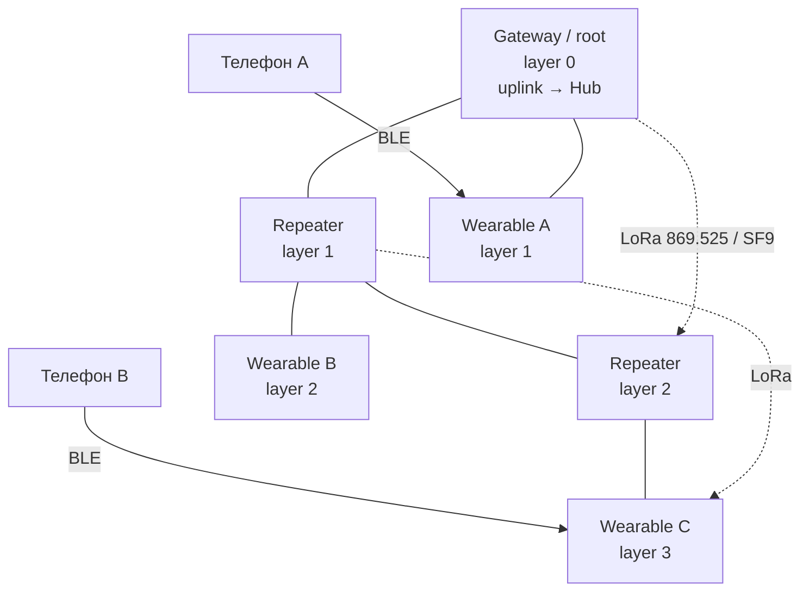
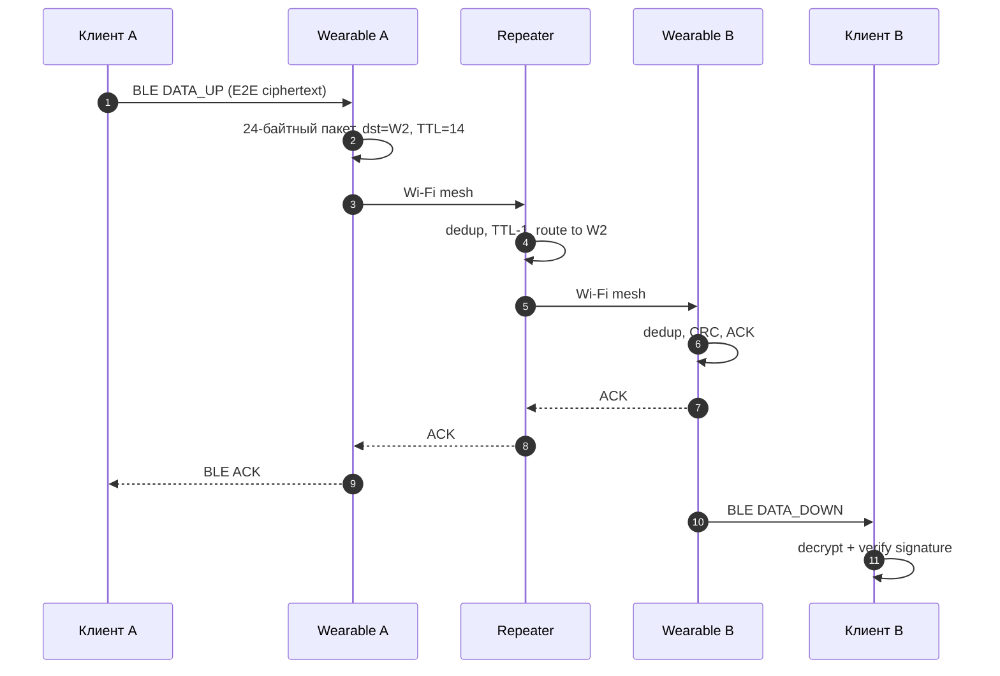
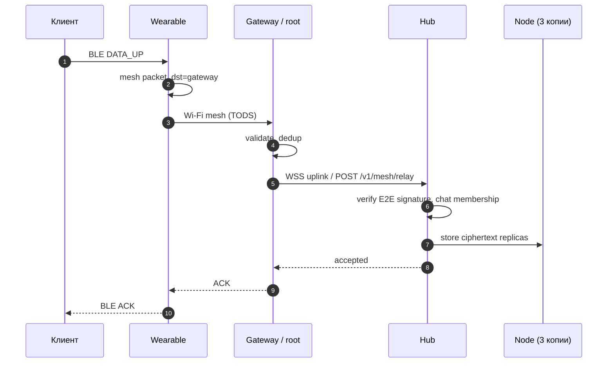
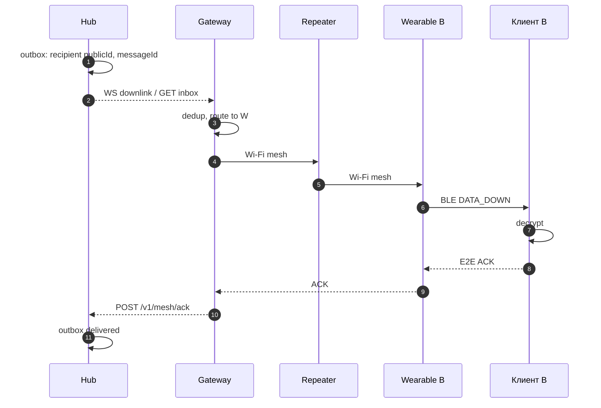
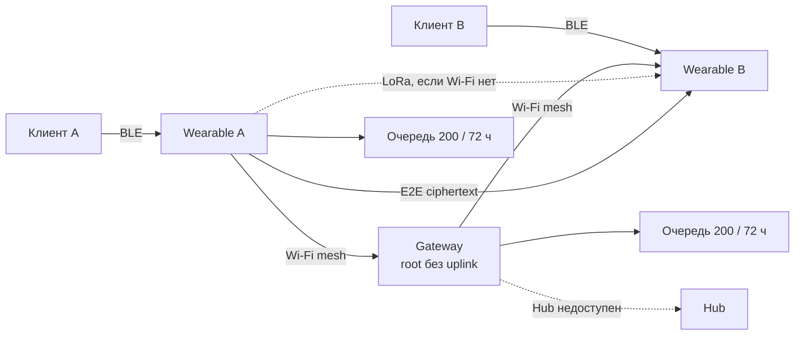
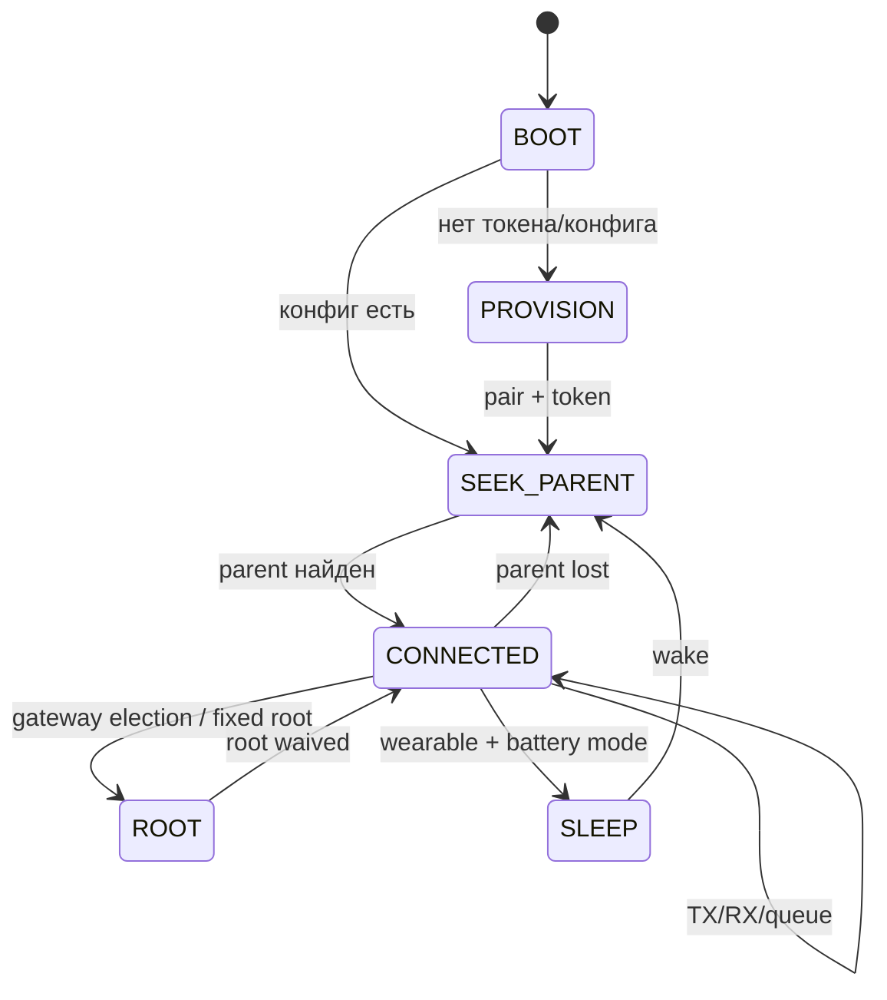

# SwarmGram — модульная mesh-архитектура (Wi-Fi + LoRa)

Статус: **утверждено, готово к поэтапной реализации firmware и сервером**.
Версия документа: **2.0** (заменяет предыдущую редакцию с per-account Wi-Fi-сетью).
Область: носимые модули ESP32, глобальная Wi-Fi mesh-сеть, LoRa-резерв,
BLE/USB-транспорты, маршрутизация, очередь, шлюз → Hub, медиа, безопасность.

Связанные документы и код:

- `ARCHITECTURE.md` — роли Hub / Node / Client и модель E2E.
- `client/src/modules/protocol.ts` — уже реализованный кадр BLE/USB и UUID `a5c0…`.
- `client/src/modules/transport.web.ts`, `client/src/modules/ble.native.ts` — транспорты.
- `services/hub/src/routes/modules.ts` — привязка по `hardwareId`, блокировка, check-in.
- `services/hub/src/routes/mesh.ts` — uplink/downlink/ack модулей.
- `services/hub/src/routes/network.ts` — текущая per-account сеть (подлежит миграции).
- `services/firmware-builder/templates/swarm_module.ino` — шаблон прошивки.
- `firmware/messenger_module/messenger_module.ino` — legacy-прошивка (старые UUID).

---

## 0. Утверждённые параметры — единственный источник истины

Любое расхождение между этим разделом и остальным текстом трактуется в пользу
раздела 0. Параметры не зависят от аккаунта, пользователя или региона (кроме
юридических ограничений на радио, см. риски).

### 0.1 Wi-Fi mesh

| Параметр | Значение |
| --- | --- |
| Тип сети | одна **глобальная** скрытая Wi-Fi mesh-сеть для всех модулей SwarmGram |
| SSID | `SG-MESH` |
| Пароль | `sgmesh-2026-11-11-a7f3c9d2e6b14580` |
| Канал | **11** (2.4 ГГц, 20 МГц) |
| Скрытый SSID | да, `hidden=true` |
| Максимум Wi-Fi-хопов | **14** |
| Стек | ESP-WIFI-MESH (ESP-IDF), root — у шлюза |
| Root без интернета | разрешён: root без роутера/без uplink, только локальный mesh |

> Целевые `SG-MESH`/hidden обязательны. В stock ESP-IDF mesh softAP не даёт
> задать произвольный SSID/hidden — это риск R1, а не разрешение менять
> параметр. Канал 11 должен совпадать с каналом роутера gateway (R10).

### 0.2 LoRa

| Параметр | Значение |
| --- | --- |
| Частота | **869.525 МГц** |
| Spreading Factor | **SF9** |
| Bandwidth | **125 кГц** |
| Coding Rate | **4/5** |
| Sync word | **0x12** |
| Мощность | **+17 dBm** (проверять ERP с антенной) |
| Максимум LoRa-хопов | **12** |
| Максимальный кадр | **200 байт** (24 заголовок + до 176 payload) |

### 0.3 Роли и идентификаторы

| Параметр | Значение |
| --- | --- |
| Роли | `wearable`, `repeater`, `gateway` |
| `hardwareId` | `esp32-<MAC>`; MAC из eFuse, нижний регистр, 12 hex-символов |
| `routeId` (mesh) | полный 32-бит FNV-1a от `hardwareId` |
| `publicId` (UI/API) | `FNV-1a32(hardwareId) % 100000000`, 8 цифр с ведущими нулями |
| Перепривязка | мягкая, по `hardwareId`/`publicId` или физическому BLE/USB-подключению |
| Shadow | запись у старого владельца после перепривязки |

### 0.4 Очередь, транспорт, приоритеты

| Параметр | Значение |
| --- | --- |
| Очередь узла | **200 пакетов** |
| TTL пакета | **72 часа** |
| Приоритет каналов клиента | интернет → Wi-Fi mesh → LoRa mesh |
| Через LoRa | текст, события, превью с деградацией; медиа — нет |
| Полные медиа | только через интернет/шлюз |
| Превью | ≤ **64 КБ**, чанками |
| BLE GATT | service `a5c0`, TX write `a5c1`, RX notify `a5c2`, STATUS `a5c3` |
| Кадр BLE/USB | magic `0xA5 0x5A`, version `1`, type, len u16, payload, CRC16-CCITT |

### 0.5 Что означает «глобальная сеть»

- SSID и пароль одинаковы у всех модулей всех пользователей.
- Нет per-user `networkId`, нет per-user SSID, нет пользовательской ротации пароля.
- Пароль — **не секрет пользователя**, а общеизвестный сетевой PSK, извлекаемый из
  прошивки. Конфиденциальность обеспечивает только E2E-шифрование payload.
- Изоляция пользователей, прав и получателей — на уровне Hub (токен модуля,
  подпись конверта, членство в чате), а не на уровне Wi-Fi.

---

## 1. Роли, возможности и сценарии клиента

### 1.1 Роли модулей

| Роль | Назначение | Wi-Fi | LoRa | BLE | USB CDC | Питание | Deep sleep |
| --- | --- | --- | --- | --- | --- | --- | --- |
| **wearable** | Носимый мост «телефон ↔ mesh» | STA + AP (mesh-узел) | опционально | peripheral к телефону | provisioning/зарядка | батарея | да, с потерей транзита |
| **repeater** | Расширение покрытия, стационарный узел | STA + AP (mesh-узел) | опционально | нет или служебный | прошивка/отладка | сеть/солнце | нет |
| **gateway** | Root mesh + выход в интернет/Hub | root + STA к роутеру | опционально | опционально | прошивка/отладка | сеть | нет |

Роль — это **основное назначение**, а не жёсткий запрет. Возможности передаются
флагами в `HELLO`/`INFO`:

| Флаг | Значение |
| --- | --- |
| `CAP_BLE_BRIDGE` | умеет принимать/отдавать конверты по BLE |
| `CAP_LORA` | есть LoRa-радио и он инициализирован |
| `CAP_WIFI_BRIDGE` | может быть транзитным Wi-Fi-узлом |
| `CAP_ROOT_CANDIDATE` | может стать корнем (обычно gateway) |
| `CAP_HAS_INTERNET` | сейчас есть рабочий uplink в Hub |
| `CAP_MEDIA_PREVIEW` | принимает/отдаёт превью ≤64 КБ |
| `CAP_DEEP_SLEEP` | умеет уходить в сон и терять транзит |

### 1.2 Что умеет и чего не умеет каждая роль

**wearable**

- Принимает E2E-конверт от телефона по BLE (или USB при наладке), упаковывает в
  mesh-пакет, выбирает Wi-Fi или LoRa.
- Отдаёт входящие конверты телефону по BLE notify.
- Может быть транзитом, только если `CAP_WIFI_BRIDGE=1` и батарея выше порога
  (по умолчанию 20%); иначе остаётся листом.
- В deep sleep Wi-Fi/BLE выключены: узел не транзит, пакеты для него копятся на
  соседях и в Hub до TTL.
- Не хранит E2E-ключей и не интерпретирует payload.

**repeater**

- Держит дерево/маршруты, пересылает чужие пакеты, работает без интернета.
- Не уходит в deep sleep, иначе перестаёт быть транзитом.
- Может быть мостом Wi-Fi ↔ LoRa, если есть оба радио.
- Не обязан иметь BLE; телефон к нему не подключается (кроме служебного режима).

**gateway**

- Root Wi-Fi mesh; единственный узел, который штатно имеет uplink в Hub.
- Может работать root без роутера/интернета: локальный mesh и P2P продолжают
  работать, пакеты «в интернет» копятся в очереди.
- Держит WebSocket/HTTPS к Hub, батчит uplink, принимает downlink.
- Не уходит в deep sleep; OTA только через Wi-Fi/локально, не через LoRa.

### 1.3 Сценарии клиента

**A. Подготовленный модуль (уже прошит и привязан).**

1. Клиент сканирует BLE по service UUID `a5c0`.
2. Находит сохранённый `hardwareId`/`publicId`, подключается автоматически.
3. `HELLO → INFO`, проверяет `publicId`, роль, батарею, очередь.
4. Вызывает `POST /v1/modules/:id/attach` (BLE) или attach по USB.
5. Отправляет конверты; модуль сам выбирает транспорт.

**B. Новый/непривязанный модуль.**

1. Модуль advertising с именем `SG-<publicId>`, service `a5c0`, manufacturer data:
   magic, версия, `publicId`, роль.
2. Клиент подключается, получает `INFO` с `hardwareId` и `publicId`.
3. Пользователь подтверждает привязку; клиент вызывает
   `POST /v1/modules/pair { hardwareId, role }`.
4. Hub создаёт/перепривязывает запись и выдаёт `moduleToken`.
5. Модуль получает токен через BLE `PAIR`/`SET_CONFIG` (или токен уже в прошивке
   при сборке) и только после этого начинает uplink в Hub.
6. До привязки модуль может принимать `ADVERT`/`HELLO`, но не имеет права
   отправлять данные в Hub; это предотвращает анонимный трафик.

**C. Носимый модуль рядом с телефоном.**

- Телефон без интернета: BLE → wearable → Wi-Fi mesh → другой wearable → BLE.
- Телефон с интернетом: приложение может отправить напрямую в Hub, не используя
  модуль; модуль остаётся резервом.
- Модуль в deep sleep: телефон видит его offline, сообщения не теряются, а
  остаются в очереди/Hub.

**D. Ретранслятор.**

- Ставится в окне/на этаже/в лесной точке; питание от сети или солнца.
- Не требует телефона; принимает и пересылает пакеты, обновляет `ADVERT`.
- Может соединить два сегмента Wi-Fi или Wi-Fi с LoRa.

**E. Шлюз.**

- Root дерева, подключён к домашнему роутеру (канал 11) или работает без него.
- При наличии интернета: uplink в Hub, downlink, OTA, полные медиа.
- Без интернета: root без uplink; локальные сообщения идут P2P, «в интернет» —
  в очередь до 72 ч.

### 1.4 Приоритет каналов клиента

Клиент (приложение) и модуль используют один порядок:

```
1. Интернет (прямой WS/HTTPS к Hub), если он есть и Hub доступен.
2. Wi-Fi mesh, если есть маршрут до dst или до gateway и payload ≤ 1000 байт.
3. LoRa mesh, если payload ≤ 176 байт, приоритет ≤ P2 и есть маршрут/флуд.
4. Локальная очередь 200 пакетов / 72 ч.
```

Уточнения:

- «Интернет» — это не обязательно Wi-Fi телефона; это доступность Hub с клиента.
- Если интернет был, но запрос упал по таймауту, клиент не дублирует сообщение
  сразу по mesh: сначала фиксирует `messageId` в локальной очереди, затем
  пробует следующий канал. Hub и получатель дедуплицируют по `messageId`.
- Полные медиа: только шаг 1 или Wi-Fi до gateway (шаг 2) с выходом в Hub.
  Через LoRa полные медиа не передаются никогда.
- Превью ≤64 КБ: шаг 1/2; по LoRa — только микро-превью (≤120 байт) или
  деградация до текста «превью недоступно».

### 1.5 Авто-подключение

| Транспорт | Поиск | Приоритет | Повтор |
| --- | --- | --- | --- |
| BLE | scan по service `a5c0`; фильтр по `publicId`/`hardwareId` | последний модуль (`sg:module:last`), затем bonded, затем RSSI | backoff 1/2/4/8/16/30 с |
| USB (Web Serial) | `navigator.serial.getPorts()`, совпадение `hardwareId` | последний разрешённый порт | переподключение по действию пользователя |
| USB native | не поддерживается на iOS/Android | — | — |

Модуль держит advertising, пока нет централа; после отключения снова включает
advertising. Одновременно допускается один BLE-централ. При нескольких знакомых
модулях клиент выбирает последний использованный, а при его отсутствии —
сильнейший RSSI, но не подключается к чужому `hardwareId` без подтверждения.

---

## 2. Топология

### 2.1 Общая схема



- Wi-Fi-дерево строится ESP-WIFI-MESH; root — gateway.
- LoRa — независимая ячеистая сеть поверх тех же узлов; мосты — узлы с обоими
  радио.
- Один и тот же 24-байтный пакет ходит по обоим транспортам; меняется только
  флаг транспорта.

### 2.2 ESP-WIFI-MESH: root, слои, выбор родителя

**Параметры стека.**

| Параметр | Значение |
| --- | --- |
| `mesh_id` | 6 байт `SGMESH` (идентификатор MBSS, не SSID) |
| Канал | 11, фиксированный, `allow_channel_switch=false` |
| `esp_mesh_set_max_layer` | 14 |
| Максимум детей | 6 (mesh) + 0 non-mesh |
| Ёмкость сети | 300 узлов (настраивается, максимум стека 1000) |
| Root | gateway; при отсутствии интернета — root без uplink |
| Шифрование | WPA2-PSK с глобальным паролем; mesh IE crypto включён |

**Root.**

- В сети может быть несколько gateway-кандидатов, но активный root один.
- Приоритет кандидата: `CAP_HAS_INTERNET` → RSSI до роутера → стабильность
  (uptime без switch) → заряд → меньший `routeId` (детерминированный tie-break).
- Штатно используется автоматический выбор ESP-WIFI-MESH
  (`esp_mesh_fix_root(false)`) с голосованием; gateway настраивает router
  (SSID/пароль/канал 11), остальные — нет.
- Если ни один gateway не может подключиться к роутеру, разрешён **fixed root
  без router**: gateway вызывает `esp_mesh_fix_root(true)`,
  `esp_mesh_post_toDS_state(false)` и продолжает внутренний mesh. Hub недоступен,
  но P2P и локальная очередь работают.
- Если gateway вообще нет в зоне, лучший repeater может поднять аварийный
  fixed root без uplink (`hasGateway=false`), чтобы локальный mesh не распался.
  При появлении gateway он уступает root штатному кандидату.
- При появлении лучшего gateway root выполняет `esp_mesh_waive_root()` или
  `MESH_EVENT_ROOT_SWITCH_REQ`; дерево перестраивается без сброса очередей.
- `esp_mesh_allow_root_conflicts(false)` — два root в одном дереве недопустимы;
  при разделении сети каждый сегмент может временно иметь свой root, после
  слияния лишний сдаётся.

**Слои и родитель.**

- `layer` = расстояние до root; root = 0.
- Родитель выбирается стеком по RSSI, глубине и загрузке; приложение не вызывает
  Wi-Fi API в self-organized режиме.
- Предпочтение: RSSI > −70 dBm, layer < 14, загрузка < 70%, батарея > 20%.
- Гистерезис: не менять родителя при разнице RSSI < 5 dB; искать нового, если
  RSSI < −88 dBm в течение 30 с.
- Узел на layer 14 не принимает детей (лист), чтобы не превысить лимит.
- После подключения узел рассылает `HELLO`/`ADVERT` с layer, `hasGateway`,
  соседями и транспортом.

**Самовосстановление.**

| Событие | Реакция |
| --- | --- |
| Потерян родитель | узел остаётся в сети, ищет нового родителя; очередь не сбрасывается |
| Потерян root | выборы root; gateway-кандидаты конкурируют; пакеты с ACK/retry |
| Смена канала | запрещена (канал 11 фиксирован); при помехах — только перезапуск/ремонт |
| Раздел сети | каждый сегмент работает локально; после слияния route-таблицы обновляются |
| Ребёнок отключился | родитель удаляет маршруты через него, пакеты в очередь/TTL |

**Отправка.**

| Задача | API |
| --- | --- |
| Вверх к root | `esp_mesh_send(NULL, &data, MESH_DATA_TODS, …)` |
| К конкретному узлу | `esp_mesh_send(&dst_mac, &data, MESH_DATA_P2P, …)` |
| От root вниз | `esp_mesh_send(&dst_mac, &data, MESH_DATA_FROMDS, …)` |
| Broadcast | приложение: `dstId=0xFFFFFFFF` + flood; либо `MESH_OPT_SEND_GROUP` |

`dst_mac` — MAC уровня mesh, а не `routeId`. Соответствие `routeId → MAC`
хранится в route-таблице и обновляется из `HELLO`/`ADVERT`.

**Практическое ограничение 14 хопов.** Стек допускает до 25 слоёв в tree-
топологии, поэтому 14 — настраиваемый лимит, а не потолок. Но 14 хопов — это
предел, а не целевая глубина: задержка, коллизии и падение throughput делают
дальние цепочки малопригодными. Проектировать покрытие нужно на 4–6 хопов,
14 использовать как аварийный запас.

### 2.3 LoRa: flood с обучением (подход MeshCore)

LoRa не строит дерево. Используется контролируемый flood с обучением обратным
маршрутам:

1. **ADVERT** (широковещательно, TTL 12, каждые 60–180 с): `routeId`, layer,
   `hasGateway`, до 4 соседей (id + RSSI/SNR), номер advert.
2. Каждый узел запоминает, **от кого** пришёл ADVERT, и строит обратный маршрут
   `dstId → prevHop` с метрикой.
3. **DATA**: если маршрут известен и свежий — unicast на `nextHop`; если нет —
   `ROUTE_REQ` (flood, TTL 12), затем `ROUTE_REP`; если ответа нет — DATA
   флудится с TTL 12.
4. При приёме любого пакета узел учит обратный путь к `srcId` через `prevHop`
   (reverse learning), поэтому ACK и ответы идут напрямую.
5. Дубликаты отсекаются по `(srcId, packetId)` до пересылки.
6. Flood ограничен: jitter 0–250 мс перед пересылкой, не более одного
   forward на узел, broadcast не чаще 1 раза в 5 с.
7. Маршрут живёт 900 с без обновления; при устаревании — снова flood.

Это даёт «mesh без инфраструктуры»: первые пакеты дорогие (flood), дальнейшие —
дешёвые (direct), но при потере узла сеть деградирует обратно к flood.

### 2.4 Мосты Wi-Fi ↔ LoRa на каждом узле

Мостом может быть любой узел с `CAP_WIFI_BRIDGE` и `CAP_LORA` (обычно repeater
или gateway; wearable — только при включённом флаге и заряде).

| Пришло | Условие | Действие |
| --- | --- | --- |
| Wi-Fi, dst не локальный | нет Wi-Fi-маршрута, payload ≤176, приоритет ≤P2 | отправить в LoRa, `flags.LORA=1` |
| Wi-Fi, dst не локальный | есть Wi-Fi-маршрут | переслать по Wi-Fi, `flags.LORA=0` |
| LoRa, dst не локальный | есть Wi-Fi-маршрут | переслать по Wi-Fi |
| LoRa, dst не локальный | Wi-Fi-маршрута нет | переслать по LoRa (flood/direct) |
| Любой | пакет уже в dedup-кэше | не пересылать; при `ACK_REQ` отправить ACK |
| Любой | payload >176 и нужен LoRa | не отправлять; в очередь до Wi-Fi/TTL |

Правила:

- Формат пакета не меняется; мост не пересобирает payload и не трогает CRC.
- `flags.LORA` — «последний транспорт», а не «разрешён только LoRa».
- Один и тот же пакет не отправляется одновременно по двум транспортам, если
  не включён режим `dual-send` (по умолчанию выключен). Если включён — только
  для ACK/срочных событий, с общим `packetId` и dedup.
- Dedup общий для обоих транспортов: `(srcId, packetId)`.
- Мост не мостит пакеты с истёкшим TTL и не создаёт ACK на ACK.

### 2.5 Wi-Fi и LoRa: сосуществование

- Wi-Fi/BLE работают в 2.4 ГГц и делят радио ESP32; LoRa — отдельный sub-GHz
  трансивер, прямой интерференции нет.
- На ESP32-C3 одно ядро и общий 2.4 ГГц radios: одновременно BLE + ESP-WIFI-MESH +
  LoRa возможны, но RAM/CPU тесные; медиа и большой flood — только на S3/ESP32.
- BLE-соединение с телефоном имеет приоритет над mesh-трафиком; при перегрузке
  Wi-Fi mesh снижает presence/ADVERT, но не рвёт BLE.
- Антенны разнесены; LoRa-антенна не должна быть рядом с Wi-Fi-антенной.
- Канал 11 фиксирован; при зашумлении не переключаться автоматически, иначе
  потеряется совместимость с глобальной сетью.

---

## 3. Формат mesh-пакета (24 байта)

### 3.1 Заголовок

Little-endian. Payload идёт сразу за заголовком.

| Смещение | Размер | Поле | Назначение |
| --- | --- | --- | --- |
| 0 | 2 | `magic` | всегда `0xA5 0x5A` |
| 2 | 1 | `version` | версия формата, сейчас `1` |
| 3 | 1 | `type` | тип пакета, см. 3.3 |
| 4 | 1 | `flags` | битовая маска, см. 3.2 |
| 5 | 1 | `ttl/hop` | старшие 4 бита — TTL, младшие 4 — hop |
| 6 | 2 | `payloadLen` | длина payload, u16 LE |
| 8 | 4 | `srcId` | `routeId` отправителя (FNV-1a32) |
| 12 | 4 | `dstId` | `routeId` получателя; `0xFFFFFFFF` — broadcast |
| 16 | 4 | `packetId` | сквозной номер пакета от `srcId` |
| 20 | 2 | `chatTag` | младшие 16 бит FNV-1a от `chatId`; `0` — нет чата |
| 22 | 2 | `crc16` | CRC16-CCITT (см. 3.5) |
| 24 | `payloadLen` | `payload` | шифротекст/служебные данные |

**TTL/hop.** Один байт: `ttl = byte >> 4`, `hop = byte & 0x0F`. `ttl` — сколько
пересылок ещё разрешено. Начальный TTL: 14 для Wi-Fi, 12 для LoRa. При приёме:
если `dstId == self` — пакет принимается даже при `ttl == 0`; иначе если
`ttl == 0` или `hop >= ttl` — отбрасывается. При пересылке: `ttl -= 1`,
`hop += 1`. Так 14 хопов проходят полностью, а 15-й уже невозможен. Значения
0–15 достаточны для утверждённых лимитов.

**Важно:** в заголовке используются полные 32-битные `routeId`, а не 8-значные
`publicId`. `publicId` — пользовательское/серверное представление
(`routeId % 100000000`); Hub хранит соответствие `publicId ↔ hardwareId ↔
routeId`. Это снижает риск коллизий в маршрутизации; 8 цифр остаются для UI,
привязки и API.

**chatTag.** Не криптографический идентификатор и не замена `chatId`.
Нужен для быстрой маршрутизации/сортировки и метаданных. Полный `chatId`
находится внутри E2E-конверта и модулю недоступен.

### 3.2 Флаги

| Бит | Имя | Значение |
| --- | --- | --- |
| 0 | `ACK_REQ` | требуется подтверждение |
| 1 | `LORA` | последний транспорт — LoRa (0 — Wi-Fi) |
| 2 | `HAS_CHAT` | `chatTag` валиден |
| 3 | `PREVIEW` | payload — превью/чанк превью |
| 4 | `MEDIA` | payload — медиа-метаданные/чанк (полные медиа только через gateway) |
| 5 | `DIRECT` | отправитель знал маршрут и отправлял unicast |
| 6 | `GATEWAY` | пакет адресован/пришёл через gateway |
| 7 | `CONGESTED` | отправитель сигнализирует о перегрузке |

### 3.3 Типы пакетов

| Код | Тип | Payload |
| --- | --- | --- |
| `0x01` | `HELLO` | роль, прошивка, layer, caps, bootId, соседи (кратко) |
| `0x02` | `ADVERT` | layer, `hasGateway`, соседи, seq, метрика |
| `0x03` | `DATA` | E2E-шифротекст (текст/событие/превью/медиа-чанк) |
| `0x04` | `ACK` | `ackedPacketId`, статус, тип ACK (hop/e2e), retry |
| `0x05` | `ROUTE_REQ` | targetId, reqId, metric, ttl |
| `0x06` | `ROUTE_REP` | targetId, nextHop, metric, layer |
| `0x07` | `PRESENCE` | статус, батарея, layer, caps (сжато) |
| `0x08` | `CONTROL` | подтип + данные (см. 3.4) |

`0x00` и `0x09–0xFF` зарезервированы; неизвестный тип отбрасывается и
учитывается в счётчике ошибок. Служебные payload проектируются с запасом:
на LoRa — ≤176 байт (соседей ≤4), на Wi-Fi — ≤1000 байт (соседей ≤8). Если
`ADVERT`/`HELLO` не влезает в LoRa-лимит, список соседей урезается, а полный
передаётся по Wi-Fi.

### 3.4 CONTROL: подтипы

| Код | Подтип | Назначение |
| --- | --- | --- |
| `0x01` | `TIME_SYNC` | Unix-время от gateway (для TTL/очереди) |
| `0x02` | `CONGESTION` | уровень перегрузки, просьба снизить темп |
| `0x03` | `ROOT_INFO` | кто root, есть ли uplink, layer |
| `0x04` | `BLOCKED` | узел заблокирован Hub (best effort) |
| `0x05` | `CONFIG` | версия/ревизия глобального mesh_config |
| `0x06` | `MEDIA_META` | метаданные превью: objectId, size, chunks |
| `0x07` | `MEDIA_NACK` | запрос пропущенных чанков |
| `0x08` | `OTA_META` | манифест OTA (только Wi-Fi) |
| `0x09` | `OTA_CHUNK` | чанк OTA (только Wi-Fi) |
| `0x0A` | `PING` | проверка связи/метрика |

CONTROL-пакеты не содержат пользовательского текста; payload — компактный
TLV/бинарный формат. Для LoRa CONTROL ограничен 176 байтами.

### 3.5 CRC и проверка

- CRC16-CCITT: poly `0x1021`, init `0xFFFF`, без рефлексии.
- Считается по байтам **`version..chatTag` + payload**; `magic` и сам `crc16`
  не входят. Это совпадает с правилом кадра BLE/USB (CRC по `version..payload`).
- При приёме проверяются: `magic`, `version==1`, `payloadLen` совпадает с
  фактической длиной, CRC, `srcId != 0`, `dstId` не равен `srcId` (если не
  loopback-тест). Для чужого `dstId` дополнительно `ttl>0` и `hop<ttl`; для
  локального получателя `ttl==0` допустим (пакет дошёл до адресата).
- Ошибка CRC/длины — пакет отбрасывается, счётчик `crc_errors++`; ACK не
  отправляется.

### 3.6 Лимиты payload

| Транспорт | Максимальный кадр | Заголовок | Максимум payload |
| --- | --- | --- | --- |
| Wi-Fi mesh | 1024 байта | 24 | **1000** |
| LoRa | 200 байт | 24 | **176** |
| BLE (один кадр до чанкования) | 4096 байт (рекомендуется) | 8 (транспорт) | 4088 |
| USB CDC | 4096 байт (номинал; жёсткий предел 8192) | 8 | 4088 / 8184 |

Полные медиа в mesh-пакет не помещаются; они идут через Hub, а по mesh
передаются только метаданные/превью.

### 3.7 Пример 24-байтного пакета

`DATA`, TTL 14, hop 0, payload `"hi"` (2 байта), `srcId=0xDBEFC213`,
`dstId=0xD4D07303`, `packetId=0x44332211`, `chatTag=0xCDAB`:

```
A5 5A 01 03 00 0E 00 02 13 C2 EF DB 03 73 D0 D4
11 22 33 44 AB CD F6 7F 68 69
```

Разбор:

- `A5 5A` — magic;
- `01` — version;
- `03` — DATA;
- `00` — flags;
- `0E` — ttl=14, hop=0;
- `00 02` — payloadLen 2;
- `13 C2 EF DB` — srcId LE;
- `03 73 D0 D4` — dstId LE;
- `11 22 33 44` — packetId LE;
- `AB CD` — chatTag;
- `F6 7F` — CRC16;
- `68 69` — `"hi"`.

---

## 4. Маршрутизация

### 4.1 Два режима

| Режим | Когда | Как |
| --- | --- | --- |
| **Direct** | в route-таблице есть свежий маршрут до `dstId` | unicast на `nextHop`, `flags.DIRECT=1` |
| **Flood** | маршрута нет/он устарел; broadcast; route discovery | переслать один раз, TTL−1, dedup |

Порядок выбора:

```
если dst == 0xFFFFFFFF            → flood (broadcast)
иначе если route(dst) свежий      → direct
иначе если dst == gateway          → direct к gateway (если известен)
иначе                              → ROUTE_REQ → direct или DATA flood
```

### 4.2 Таблица маршрутов

Каждый узел хранит:

| Поле | Размер | Смысл |
| --- | --- | --- |
| `dstId` | 4 | `routeId` получателя |
| `nextHopId` | 4 | `routeId` следующего узла |
| `nextHopMac` | 6 | MAC уровня ESP-WIFI-MESH (для Wi-Fi) |
| `transport` | 1 | 0 — Wi-Fi, 1 — LoRa |
| `hops` | 1 | число хопов до dst |
| `metric` | 2 | чем меньше, тем лучше |
| `lastSeen` | 4 | монотонное время обновления |
| `expiresAt` | 4 | срок жизни |
| `flags` | 1 | gateway, congested, direct |

Метрика:

```
metric = hops * 16
       + (255 - minRssi)
       + transportPenalty   // Wi-Fi 0, LoRa +40
       + loadPenalty        // min(queueDepth / 10, 30)
```

- Wi-Fi-маршрут живёт 300 с, LoRa — 900 с без обновления.
- `ADVERT`/`HELLO` обновляют маршрут; `ROUTE_REP` создаёт запись.
- Маршрут к gateway помечается `flags.GATEWAY=1`.
- Петли отсекаются TTL/hop и историей `(srcId, packetId)`.

### 4.3 Обнаружение маршрута

1. Отправитель шлёт `ROUTE_REQ` (flood, TTL 12/14, `reqId`).
2. Узел, знающий dst, отвечает `ROUTE_REP` по обратному пути.
3. Промежуточные узлы кэшируют обратный маршрут и метрику.
4. Если через 3 с ответа нет — повтор до 3 раз с backoff.
5. Если ответа нет — DATA флудится; получатель отвечает ACK, и путь
   выучивается из ACK.

`ROUTE_REQ` не чаще 1 раза в 10 с на `(srcId, dstId)`.

### 4.4 TTL, dedup, порядок

**TTL.**

| Транспорт | Стартовый TTL | Максимум hop |
| --- | --- | --- |
| Wi-Fi | 14 | 14 |
| LoRa | 12 | 12 |
| Broadcast | 14 (Wi-Fi) / 12 (LoRa) | тот же |

TTL уменьшается на каждом хопе. При `ttl=0` пакет ещё принимается локальным
получателем (`dstId==self`), но не пересылается; если он не для этого узла —
удаляется, отправителю может уйти `ACK` со статусом `ttl_expired`.

**Dedup.**

| Параметр | Wearable | Repeater/Gateway |
| --- | --- | --- |
| Ключ | `(srcId, packetId)` | `(srcId, packetId)` |
| Ёмкость | 512 | 2048–4096 |
| TTL записи | 30 мин | 24 ч |
| Проверка | до ACK и до пересылки | до ACK и до пересылки |
| Медиа | `(objectId, chunkIndex)` | `(objectId, chunkIndex)` |

Дубликат подтверждается ACK (чтобы отправитель перестал ретраить), но не
доставляется и не пересылается повторно. Финальный дедуп — на клиенте по
`messageId`/ratchet-счётчику; кэш модуля не обязан помнить все 72 ч.

**Порядок.**

- Модули не гарантируют порядок доставки: `packetId` монотонен у отправителя,
  но из-за разных маршрутов и ретрансляций пакеты могут приходить не по порядку.
- Клиент сортирует по `seq`/времени внутри E2E-конверта; окно 64 сообщения,
  пропуск старше 30 с показывается как «могло потеряться».
- `packetId` — 32-битный монотонный счётчик, сохраняемый в NVS блоками по 256
  (не на каждый пакет). После перезагрузки счётчик продолжается; при потере NVS
  стартует с случайного значения.

### 4.5 ACK, retry, backoff

| Уровень | Кто отвечает | Таймаут | Что подтверждает |
| --- | --- | --- | --- |
| Link ACK | следующий узел/получатель | Wi-Fi 1.5 с, LoRa 8 с, BLE 2 с | пакет принят и проверен |
| E2E ACK | клиент получателя | 10 с (Wi-Fi), 60 с (LoRa) | сообщение расшифровано/принято |

- Retry: 3 попытки; backoff 1×/2×/4× таймаута + jitter 0–300 мс.
- После 3 неудач — в очередь store-and-forward (если TTL жив) или `failed`.
- ACK не ретранслируется бесконечно; ACK на ACK не отправляется.
- Broadcast не требует ACK; для надёжности отправитель может запросить
  E2E ACK от конкретного получателя отдельным пакетом.
- LoRa ACK учитывается в duty cycle; при исчерпании бюджета ACK откладывается,
  отправитель ретраит позже.

### 4.6 Broadcast

- `dstId=0xFFFFFFFF`, `ACK_REQ=0`.
- Flood с dedup; каждый узел пересылает не более одного раза.
- Не чаще 1 раза в 5 с на узел; presence/ADVERT имеют собственные интервалы.
- Broadcast не используется для медиа и длинных текстов.
- Broadcast от неизвестного `srcId` (не привязанного) не пересылается в Hub.

### 4.7 Перегрузка и деградация

Сигналы: очередь >70%, retry >30%, RSSI < −85 dBm, airtime LoRa >80% бюджета,
`CONTROL.CONGESTION` от соседа.

Порядок отбрасывания/деградации:

| Уровень | Что делаем |
| --- | --- |
| 0. Норма | всё разрешено |
| 1. Warning | presence/typing реже (30 с → 120 с), ADVERT реже, превью откладывается |
| 2. High | **сначала отбрасываем presence/typing**, затем старые превью; текст/события идут |
| 3. Critical | превью не принимаются; медиа-метаданные только через gateway; LoRa — только текст/события |
| 4. Emergency | только ACK/CONTROL/текст/события; presence и превью запрещены; очередь чистится по TTL |

Текст и события не отбрасываются, пока не истёк TTL или не переполнена очередь
целиком; ACK/CONTROL имеют приоритет выше текста и не вытесняются presence.

---

## 5. Очередь и хранение

### 5.1 Хранилище

| Компонент | Где | Что |
| --- | --- | --- |
| Очередь пакетов | LittleFS, раздел `meshq` (рекомендуется 512 КБ) | append-only журнал записей |
| Индекс | RAM | восстановление сканированием при старте |
| Счётчики/курсоры | NVS | `packetId`, `lastHubSeq`, `timeBase`, `idSalt` |
| Конфиг | NVS | глобальный mesh_config, роль, калибровки |
| Превью | LittleFS, отдельная папка/область | до 2 объектов, ≤64 КБ каждый |

NVS не используется для payload: частая запись убивает flash. NVS — только
маленькие счётчики и конфиг.

### 5.2 Запись очереди

| Поле | Размер | Смысл |
| --- | --- | --- |
| `magic` | 2 | `0x5145` (`QE`) |
| `version` | 1 | 1 |
| `priority` | 1 | 0–3 |
| `state` | 1 | queued/sending/wait_ack/done/expired/failed |
| `attempts` | 1 | число попыток |
| `reserved` | 2 | выравнивание |
| `createdAt` | 8 | Unix ms (или монотонное время) |
| `expiresAt` | 8 | createdAt + 72 ч |
| `nextTryAt` | 8 | backoff |
| `packetLen` | 2 | 24 + payloadLen |
| `crc16` | 2 | CRC записи |
| `srcId` | 4 | для индекса |
| `dstId` | 4 | для индекса |
| `packetId` | 4 | для dedup/ACK |
| `chatTag` | 2 | метаданные |
| `flags` | 2 | копия флагов |
| `packet` | `packetLen` | 24-байтный заголовок + payload |

CRC записи считается по заголовку записи (с `crc16=0`) и `packet`; при
несовпадении запись считается битой и обрезается вместе с хвостом.

Максимальный размер записи: 52 + 1024 ≈ 1076 байт; 200 записей ≈ 215 КБ,
плюс запас на compaction — 512 КБ достаточно.

### 5.3 Приоритеты и вытеснение

| Приоритет | Что | Вытесняется |
| --- | --- | --- |
| P0 | ACK, CONTROL, ROUTE | только по TTL |
| P1 | текст, события | после P2/P3 |
| P2 | превью/медиа-метаданные | после P3 |
| P3 | presence, typing, телеметрия | первым |

Правила:

- При заполнении: сначала удалить истёкшие, затем P3, затем P2, затем самые
  старые P1. P0 не вытесняется, пока не истёк TTL.
- Если очередь заполнена P0/P1 и новый пакет не помещается — вернуть
  `queue_full`/ACK error; клиент повторит позже.
- P3 не считается надёжной доставкой; presence может быть потерян.
- Медиа-превью занимает слоты P2, но не более 2 активных объектов; чанки
  старого превью вытесняются первыми.

### 5.4 TTL 72 часа

- `expiresAt = createdAt + 72*3600*1000`.
- Проверка при постановке, при извлечении и периодическим сканом каждые 10 мин.
- Истёкшие записи удаляются без отправки; отправителю (если он локально) —
  событие `expired`.
- Время: RTC нет. Источник — `CONTROL.TIME_SYNC` от gateway, `checkin`-ответ Hub,
  последняя известная метка + uptime. Если время недостоверно, TTL считается
  консервативно от загрузки, а в телеметрии ставится `timeValid=false`.
- После перезагрузки записи восстанавливаются с сохранёнными `createdAt`;
  если часы «прыгнули» назад, TTL не продлевается.

### 5.5 Восстановление после сбоя

1. При старте LittleFS сканирует журнал от начала.
2. Каждая запись проверяется по CRC; битый хвост обрезается.
3. Индекс строится в RAM: `packetId → offset`, `state`, `priority`.
4. Записи `sending` переводятся в `queued` (могли не получить ACK).
5. `done`/`expired` помечаются к удалению; compaction — по порогу мусора.
6. `packetId` читается из NVS; если NVS потерян — новый случайный старт,
   дубли отсекаются E2E-дедупом.

### 5.6 Защита flash от износа

- Append-only журнал, без перезаписи всей очереди на каждый пакет.
- LittleFS выполняет wear leveling; раздел не менее 512 КБ.
- `fsync` батчами: не чаще раза в 5 с или каждые 8 записей; ACK клиенту
  отправляется после фиксации батча (для текста), presence — без fsync.
- Compaction только при мусоре >50%, не чаще раза в час.
- NVS-счётчик `packetId` резервируется блоками по 256, а не пишется на пакет.
- Оценка: при 100 сообщениях/день и 300 байтах среднего размера — ~11 МБ/год
  записи; 4 МБ flash с wear leveling выдерживает годы, но требует стендового
  теста (см. 13.2).

### 5.7 Очередь модуля и outbox Hub

- 200 пакетов — лимит **узла** (включая gateway). Gateway не хранит больше
  локально; после передачи Hub ответственность за офлайн-получателя несёт
  outbox Hub (раздел 9.5).
- Если Hub недоступен дольше 72 ч, пакеты истекают и удаляются; отправитель
  получает `expired` при следующем контакте.

---

## 6. BLE и USB протокол

### 6.1 BLE GATT

| UUID | Имя | Свойства | Назначение |
| --- | --- | --- | --- |
| `0000a5c0-0000-1000-8000-00805f9b34fb` | Service | — | основной сервис |
| `0000a5c1-…` | TX | Write, Write Without Response | телефон → модуль |
| `0000a5c2-…` | RX | Notify | модуль → телефон |
| `0000a5c3-…` | STATUS | Read, Notify | статус/телеметрия |

Короткие UUID для фильтра сканирования: `a5c0`, `a5c1`, `a5c2`, `a5c3`.
Advertising: имя `SG-<publicId>`, service UUID `a5c0`, manufacturer data:
magic `A5 5A`, версия, `publicId` (u32), роль, флаги.

Стандартные Battery/Device Information могут быть добавлены, но протокол от
них не зависит.

### 6.2 Кадр

```
+------+------+---------+------+---------+--------+---------+
| 0xA5 | 0x5A | version | type | len LE  | payload| crc16   |
+------+------+---------+------+---------+--------+---------+
  1      1        1        1      2        len       2
```

- Заголовок 6 байт, полный оверхед 8 байт.
- `version=1`; `type` — см. 6.3; `len` — u16 LE.
- CRC16-CCITT (poly `0x1021`, init `0xFFFF`) по байтам **`version..payload`**;
  `magic` и CRC не входят. Это ровно то, что реализовано в
  `client/src/modules/protocol.ts`.
- Payload — UTF-8 JSON для HELLO/INFO/STATUS/ACK/PING/PONG/PAIR/SET_CONFIG и
  JSON-конверт для DATA_UP/DATA_DOWN. Модуль не интерпретирует E2E-содержимое.
- Приёмник синхронизируется по magic, проверяет version/len/CRC; мусор до
  magic отбрасывается.

### 6.3 Типы кадров

| Код | Тип | Направление | Payload |
| --- | --- | --- | --- |
| `0x01` | `HELLO` | телефон → модуль | `{v:1, kind:'hello', app, client, expectHardwareId?}` |
| `0x02` | `INFO` | модуль → телефон | `{hardwareId, publicId, role, firmware, battery, meshRole, attached, queue, rssi, …}` |
| `0x03` | `DATA_UP` | телефон → модуль | `{v:1, kind:'envelope', direction:'up', chatId, envelope}` |
| `0x04` | `DATA_DOWN` | модуль → телефон | `{v:1, kind:'envelope', direction:'down', chatId, envelope}` |
| `0x05` | `ACK` | оба | `{v:1, kind:'ack', id?, ok, error?}` |
| `0x06` | `PING` | оба | `{v:1, kind:'ping'}` |
| `0x07` | `PONG` | оба | `{v:1, kind:'pong'}` |
| `0x08` | `STATUS` | модуль → телефон | `{v:1, kind:'status', attached, queue, rssi, battery, meshRole, …}` |
| `0x09` | `PAIR` | телефон → модуль | привязка/токен (только доверенный сценарий) |
| `0x0A` | `SET_CONFIG` | телефон → модуль | локальный provisioning (USB/подтверждение кнопкой) |

Типы совпадают с существующим клиентом; новые поля (`publicId`, `layer`,
`parentRssi`, `loraState`, `bootId`) добавляются в JSON и игнорируются старым
клиентом.

### 6.4 Handshake HELLO → INFO

1. Клиент подключается, подписывается на `a5c2` (RX) и `a5c3` (STATUS).
2. Пишет в `a5c1` кадр `HELLO`:
   ```json
   {"v":1,"kind":"hello","app":"swarmgram","client":"native-ble","expectHardwareId":"esp32-a1b2c3d4e5f6"}
   ```
3. Модуль отвечает `INFO` (notify `a5c2` и/или read `a5c3`):
   ```json
   {
     "v":1,"kind":"info",
     "hardwareId":"esp32-a1b2c3d4e5f6",
     "publicId":"89923091",
     "role":"wearable",
     "firmware":"2.0.0",
     "battery":76,
     "meshRole":"layer-2",
     "attached":true,
     "queue":3,
     "rssi":-61,
     "layer":2,
     "parentRssi":-58,
     "channel":11,
     "loraState":"ready",
     "caps":["CAP_BLE_BRIDGE","CAP_LORA"],
     "bootId":"0x1a2b3c4d"
   }
   ```
4. Клиент проверяет `hardwareId`/`publicId`, при необходимости предупреждает о
   старой прошивке (`networkRevision`/`configRevision`).
5. Опционально: `PAIR`/`SET_CONFIG` с токеном привязки. Текущий клиент не шлёт
   токен в HELLO; модуль должен разрешать только безопасные операции до
   подтверждения (см. риски R12).
6. При неудаче/таймауте — разрыв через 5 с.

### 6.5 MTU, чанки, reassembly

| Платформа | MTU | Размер записи в TX |
| --- | --- | --- |
| Web Bluetooth | фактический ATT (часто 23) | 20 байт (как в существующем клиенте) |
| iOS native | ~185 | `mtu - 3` |
| Android native | 185–517 (запрос 185/247) | `mtu - 3` |
| USB CDC | поток | без чанкования, кадр целиком |

- Кадр режется на чанки по `mtu - 3`; каждый чанк — `writeValue`/notify.
- Приёмник собирает по заголовку `len`; отдельного offset нет.
- Максимальный собираемый кадр: 4096 байт (жёсткий предел 8192).
- Реассемблирование: 4 параллельных потока, таймаут 10 с, переполнение —
  сброс потока и `ACK {ok:false,error:'frame_too_large'}`.
- `STATUS.busy`/очередь >80% — сигнал клиенту снизить темп; flow control на
  уровне приложения.

### 6.6 Таймауты и переподключение

| Параметр | Значение |
| --- | --- |
| Подключение BLE | 10–15 с |
| Handshake | 5 с |
| Ожидание ACK | 2 с |
| Реассемблирование | 10 с |
| Idle | 30 с → мягкий disconnect |
| Повтор | backoff 1/2/4/8/16/30 с |
| USB открытие | 3 с (как в клиенте) |

После разрыва модуль снова advertising; клиент пытается `openKnown` по
`hardwareId`, не показывая системный выбор устройства.

### 6.7 USB CDC

- Web Serial: `baudRate: 115200`, `bufferSize: 4096` (совпадает с клиентом).
- Нативный USB Serial/JTAG ESP32-C3/S3 игнорирует baud; DTR asserted.
- 8N1, без flow control; кадры те же, что BLE.
- USB — provisioning/наладка/DFU/резерв; в эксплуатации основный канал — BLE.
- Legacy-прошивка `messenger_module` использует magic `'S' 'G'` и CRC32;
  новая прошивка определяет магию и поддерживает legacy-режим (см. 15.1).

### 6.8 Примеры байтов

**HELLO (JSON, CRC по version..payload):**

```
A5 5A 01 01 37 00
7B 22 76 22 3A 31 2C 22 6B 69 6E 64 22 3A 22 68
65 6C 6C 6F 22 2C 22 61 70 70 22 3A 22 73 77 61
72 6D 67 72 61 6D 22 2C 22 63 6C 69 65 6E 74 22
3A 22 64 6F 63 22 7D
78 4A
```

`37 00` — payloadLen 55; `78 4A` — CRC16 `0x4A78`.

**DATA_UP (минимальный конверт):**

```
A5 5A 01 03 47 00
7B 22 76 22 3A 31 2C 22 6B 69 6E 64 22 3A 22 65
6E 76 65 6C 6F 70 65 22 2C 22 64 69 72 65 63 74
69 6F 6E 22 3A 22 75 70 22 2C 22 63 68 61 74 49
64 22 3A 22 63 31 22 2C 22 65 6E 76 65 6C 6F 70
65 22 3A 22 78 22 7D
58 5A
```

`47 00` — 71 байт payload; CRC `0x5A58`.

Модуль, получив `DATA_UP`, сериализует `envelope` в opaque bytes, добавляет
24-байтный mesh-заголовок и отправляет по Wi-Fi/LoRa. Обратный путь:
`DATA_DOWN` с тем же JSON-конвертом.

---

## 7. Wi-Fi ESP-WIFI-MESH

### 7.1 Инициализация

```c
esp_netif_init();
esp_event_loop_create_default();

wifi_init_config_t wcfg = WIFI_INIT_CONFIG_DEFAULT();
esp_wifi_init(&wcfg);
esp_wifi_set_storage(WIFI_STORAGE_FLASH);
esp_wifi_start();

mesh_cfg_t cfg = MESH_INIT_CONFIG_DEFAULT();
memcpy(cfg.mesh_id, "SGMESH", 6);          // 6-байтный MBSS id
cfg.channel = 11;                           // утверждённый канал
cfg.allow_channel_switch = false;

// Только gateway-кандидат:
cfg.router.ssid_len = strlen(homeSsid);
memcpy(cfg.router.ssid, homeSsid, cfg.router.ssid_len);
memcpy(cfg.router.password, homePass, strlen(homePass));
// Роутер должен работать на канале 11: cfg.channel должен совпадать с ним.

cfg.mesh_ap.max_connection = 6;
cfg.mesh_ap.nonmesh_max_connection = 0;
memcpy(cfg.mesh_ap.password, SG_MESH_PASS, strlen(SG_MESH_PASS));

esp_mesh_set_config(&cfg);
esp_mesh_set_max_layer(14);
esp_mesh_set_capacity_num(300);
esp_mesh_set_ap_authmode(WIFI_AUTH_WPA2_PSK);
esp_mesh_set_self_organized(true, true);
esp_mesh_start();
```

После `esp_mesh_start()` приложение не вызывает Wi-Fi API в self-organized
режиме. Для ручного сканирования — сначала `esp_mesh_set_self_organized(false,
false)`, затем сканирование и обратное включение.

### 7.2 Root и gateway

- Root — узел layer 0; только root вызывает `esp_mesh_recv_toDS()` и держит
  сокет до Hub.
- Gateway с интернетом: `esp_mesh_post_toDS_state(true)`, WS/HTTPS к Hub.
- Gateway без интернета: `esp_mesh_post_toDS_state(false)`; root продолжает
  обслуживать внутренний mesh; Hub-трафик в очередь.
- Fixed root для сценария «без роутера»:
  `esp_mesh_fix_root(true)` на gateway; остальные — обычные узлы.
- При нескольких gateway: авто-выборы; при конфликте root —
  `esp_mesh_allow_root_conflicts(false)`; лучший кандидат забирает root,
  прежний становится обычным узлом.
- Смена root не сбрасывает очередь; пакеты, потерянные в момент switch,
  ретраятся.

### 7.3 Layer, parent, RSSI

- `esp_mesh_get_layer()` — текущий слой; `esp_mesh_get_parent_bssid()` — родитель.
- Parent RSSI: `esp_wifi_sta_get_ap_info()`; child RSSI — из событий и `esp_mesh_get_routing_table()`.
- Порог выбора: > −70 хороший, −70…−80 допустимый, < −85 избегать.
- Гистерезис 5 dB; переподключение при < −88 dBm 30 с.
- `layer == 14` — лист; дети не принимаются.
- После `MESH_EVENT_PARENT_CONNECTED` узел отправляет `HELLO`/`ADVERT` с layer,
  `hasGateway`, соседями.
- `MESH_EVENT_PARENT_DISCONNECTED` → `SEEKING_PARENT`, очередь не трогается.

### 7.4 Отправка и приём

```c
// вверх к root
mesh_data_t d = { .data = pkt, .size = len, .proto = MESH_PROTO_BIN, .tos = MESH_TOS_P2P };
esp_mesh_send(NULL, &d, MESH_DATA_TODS, NULL, 0);

// к конкретному узлу
esp_mesh_send(&dst_mac, &d, MESH_DATA_P2P, NULL, 0);

// root → вниз
esp_mesh_send(&dst_mac, &d, MESH_DATA_FROMDS, NULL, 0);
```

- `esp_mesh_recv()` в отдельной задаче; проверять `esp_mesh_get_rx_pending()`,
  чтобы не переполнить RX-очередь.
- `MESH_DATA_TODS` — вверх; `MESH_DATA_FROMDS` — от root; `MESH_DATA_P2P` —
  между узлами.
- Broadcast на уровне приложения: `dstId=0xFFFFFFFF` + flood; ESP-MESH group
  send — оптимизация, не замена dedup.

### 7.5 Скрытый SSID, канал 11

- Целевые параметры: SSID `SG-MESH`, hidden, channel 11.
- `mesh_ap_cfg_t` в stock ESP-IDF задаёт пароль/число соединений, но **не
  произвольный SSID и не hidden-флаг**. Это известное ограничение стека
  (см. риск R1). Для точного соответствия нужен один из вариантов:
  1) патч/расширение ESP-IDF, задающее SSID/hidden для mesh softAP;
  2) ESP-Mesh-Lite (тот же Wi-Fi mesh-подход) с настраиваемым префиксом SSID и
     hidden;
  3) переход на ручной AP+STA (не соответствует утверждённому стеку, только
     как аварийный fallback).
- Если stock-стек не позволяет SSID, **нельзя молча менять `SG-MESH`**:
  требуется решение архитектора и проверка на железе.
- Скрытый SSID — не безопасность: beacon/ассоциация всё равно выдаёт сеть.
- Канал 11 должен совпадать с каналом домашнего роутера gateway. Если роутер
  на другом канале, root не сможет одновременно быть STA к роутеру и mesh на
  11; варианты: перевести роутер на 11 или работать root без роутера.
- `allow_channel_switch=false`: при помехах сеть не переезжает; это цена
  глобальной совместимости.

### 7.6 Диагностика

В `INFO`/`checkin`/`STATUS` отдавать:

- `layer`, `parentRssi`, `rssi`, `channel`, `role`, `root` (bool),
  `hasGateway`, `queue`, `freeHeap`, `uptime`, `bootId`;
- соседи: `routeId`, `rssi`, `transport`, `hasGateway`, `lastSeen`;
- LoRa: `loraState`, `loraRssi`, `loraSnr`, `dutyUsedMs`, `dutyBudgetMs`.

---

## 8. LoRa

### 8.1 Железо и библиотеки

| Радио | Библиотека | Особенности |
| --- | --- | --- |
| SX1262 | RadioLib | BUSY-пин, DIO1, TCXO, RF switch |
| SX127x | Sandeep Mistry `LoRa` | DIO0, без BUSY |
| Антенна | 869 МГц, 50 Ом | ERP проверять; +17 dBm conducted |

SX1262 (RadioLib, ориентировочно):

```cpp
SX1262 radio = new Module(NSS, DIO1, RESET, BUSY);
radio.begin(869.525, 125.0, 9, 5, 0x12, 17);
radio.setDio2AsRfSwitch(true);
radio.setTCXO(1.7);
radio.startReceive();
```

`CR=5` в RadioLib означает 4/5. Проверить `setCRC(true)`, explicit header,
preamble 8–12 символов.

SX127x (Sandeep Mistry):

```cpp
LoRa.begin(869.525E6);
LoRa.setSpreadingFactor(9);
LoRa.setSignalBandwidth(125E3);
LoRa.setCodingRate4(5);
LoRa.setSyncWord(0x12);
LoRa.setTxPower(17);
```

### 8.2 Параметры

| Параметр | Значение |
| --- | --- |
| Частота | 869.525 МГц |
| SF | 9 |
| BW | 125 кГц |
| CR | 4/5 |
| Sync | 0x12 |
| Power | +17 dBm |
| Preamble | 8–12 символов |
| CRC | on |
| Header | explicit |
| Максимальный кадр | 200 байт |

### 8.3 DIO/BUSY

- SX1262: перед каждой SPI-командой ждать `BUSY=0` (poll 1–5 мс, timeout
  100 мс). DIO1 — `RxDone`, `TxDone`, `Timeout`, `CrcErr`; после события
  прочитать IRQ status и сбросить.
- SX127x: DIO0 — `TxDone`/`RxDone`; DIO1 — `Timeout` (если подключён).
- После TX сразу вернуться в continuous RX, иначе можно пропустить пакет.
- При `CrcErr` пакет отбросить, счётчик ошибок; не отправлять ACK.

### 8.4 Отправка/приём

1. Собрать 24-байтный заголовок + payload ≤176; проверить CRC.
2. Проверить duty budget и CAD/LBT.
3. `startTransmit`; дождаться `TxDone`; учесть airtime.
4. Вернуться в RX; по `RxDone` прочитать данные, RSSI/SNR.
5. Проверить CRC/длину/TTL; dedup; передать в маршрутизацию/мост.

### 8.5 Duty cycle и LBT

- EU 869.525 (band g1) — **10%** duty cycle, ERP до 500 мВт (27 dBm).
- Внутренняя политика по умолчанию:
  - wearable: **1%** (экономия и запас);
  - repeater/gateway: до **10%**, но с приоритетом ACK/текст.
- Учёт: rolling-окно 1 час, `txAirMs` в NVS; перед TX:
  `used + airtime <= budget` (360 с при 10%, 36 с при 1%).
- Если бюджет исчерпан — пакет в очередь, TX откладывается; presence/ADVERT
  пропускаются первыми.
- LBT/CAD: проверить канал перед TX; при занятости — backoff 50–500 мс.
- Антенна: +17 dBm conducted; при усилении >10 dBi ERP превысит 27 dBm —
  снижать мощность.
- Юридические нормы зависят от страны; 869.525 — EU-план, для других регионов
  требуется отдельная проверка (риск R5).

### 8.6 Дальность и скорость

| Условие | Дальность (оценка) | Примечание |
| --- | --- | --- |
| Город, здания | 300–800 м | стены, этажи |
| Пригород | 1–3 км | прямая видимость частично |
| Село/поле | 3–8 км | хорошая антенна, высота |
| 12 хопов | десятки км теоретически | но throughput падает в 12 раз |

Скорость: SF9/BW125 raw ≈ **1.76 кбит/с**; кадр 200 байт ≈ **1.0 с** воздуха.
Это не канал для медиа и не замена Wi-Fi.

---

## 9. Шлюз → Hub

### 9.1 Транспорт

| Режим | Когда | Протокол |
| --- | --- | --- |
| WebSocket | основной, постоянный | `wss://<hub>/v1/mesh/ws` |
| HTTPS batch | WS недоступен | `POST /v1/mesh/batch` |
| HTTPS relay | fallback по одному | `POST /v1/mesh/relay` (существующий) |
| Downlink push | WS | frame `downlink` |
| Downlink poll | WS нет | `GET /v1/mesh/inbox` / `GET /v1/mesh/downlink` |

Gateway держит WS, пока есть интернет; при обрыве — экспоненциальный backoff
1/2/5/15/30/60 с, затем polling.

### 9.2 Аутентификация

- `Authorization: Bearer <moduleToken>` — существующий JWT модуля (365 дней).
- Заголовки/поля: `x-sg-public-id`, `x-sg-hardware-id`, `x-sg-fw`.
- Hub проверяет:
  1) токен валиден и `type=module`;
  2) `publicId` соответствует `hardwareId` (FNV % 1e8);
  3) модуль не заблокирован (`blocked`, `blocked_nodes`);
  4) `token_version` не отозван (при перепривязке инкрементируется);
  5) для relay — право ретрансляции (владелец/public/personal.is_public/общий чат).
- Gateway не подписывает чужие конверты: он передаёт исходные `x-sg-device-id`,
  `x-sg-sig`, `x-sg-nonce`, `x-sg-chat-id`; Hub проверяет E2E-подпись отправителя.
- Модуль без токена (новый) не имеет права uplink; только BLE provisioning.

### 9.3 Uplink

**Одиночный (совместимый, уже есть):**

```
POST /v1/mesh/relay
Authorization: Bearer <moduleToken>
x-sg-chat-id: <uuid>
x-sg-nonce: <base64>
x-sg-kind: text|event|preview|media
x-sg-client-id: <idempotency>
x-sg-header: <base64 json>
x-sg-sig: <ECDSA-P256>
x-sg-device-id: <uuid>
Content-Type: application/octet-stream
<шифротекст>
```

**Батч (предлагаемый контракт):**

```json
POST /v1/mesh/batch
{
  "publicId": "89923091",
  "hardwareId": "esp32-a1b2c3d4e5f6",
  "messages": [
    {
      "chatId": "uuid",
      "messageId": "uuid",
      "packetId": 1144201745,
      "kind": "text",
      "nonce": "base64",
      "header": {},
      "sig": "base64",
      "deviceId": "uuid",
      "ciphertext": "base64",
      "createdAt": "2026-11-11T12:00:00Z"
    }
  ]
}
```

Ответ:

```json
{ "accepted": ["uuid"], "duplicates": [], "rejected": [{"messageId":"uuid","error":"chat_blocked"}] }
```

- Максимум 50 сообщений или 1 МБ на батч; больше — несколько батчей.
- Порядок: P0 ACK/control, P1 текст/события, P2 превью; медиа — отдельным
  потоком/после.
- Каждое сообщение идемпотентно по `messageId`/`clientId`.

### 9.4 Downlink

**WS push:**

```json
{
  "type": "downlink",
  "seq": 12345,
  "items": [
    {
      "messageId": "uuid",
      "chatId": "uuid",
      "kind": "text",
      "nonce": "base64",
      "header": {},
      "fragmentUrl": "https://node/...",
      "ticket": "...",
      "sizeBytes": 321,
      "expiresAt": "..."
    }
  ]
}
```

**Poll (совместимый):**

```
GET /v1/mesh/inbox?username=<peer>&since=<seq>&limit=20
GET /v1/mesh/downlink?publicIds=89923091,70430723&since=<seq>&limit=50
```

- `since` — курсор Hub `seq`; gateway хранит `lastHubSeq` в NVS.
- После доставки в mesh — `POST /v1/mesh/ack { username, messageIds }`
  (существующий) или `{ publicId, messageIds }` (расширение).
- Hub не отдаёт одно и то же повторно без `since`; повторный ACK идемпотентен.

### 9.5 Hub хранит сообщения офлайн-получателей

- Hub уже хранит метаданные сообщений и ссылки на шифротекст (объекты на Node).
  Добавляется **outbox** для доставки конкретному `publicId`:

| Поле | Смысл |
| --- | --- |
| `id` | uuid |
| `recipient_public_id` | 8-значный ID |
| `recipient_hardware_id` | для проверки |
| `message_id` | дедуп |
| `chat_id` | чат |
| `object_id` | шифротекст на Node |
| `priority` | P0–P3 |
| `state` | pending/delivered/expired |
| `attempts` | число попыток |
| `created_at` / `expires_at` | retention (по умолчанию 30 дней) |
| `delivered_at` | когда ACK |

- Если получатель онлайн в приложении — Hub отдаёт по WS напрямую и помечает
  outbox `delivered`.
- Если онлайн только модуль — при следующем downlink/poll отдаёт пакет;
  после ACK модуля — `delivered`.
- Если офлайн — outbox ждёт; mesh-очередь модуля ограничена 72 ч, outbox Hub —
  30 дней (настраивается).
- Hub не хранит plaintext; только ссылки на шифротекст и метаданные.

### 9.6 Офлайн-поведение шлюза

| Ситуация | Поведение |
| --- | --- |
| WS упал | 200 пакетов в локальной очереди; backoff; batch при восстановлении |
| Hub 5xx | retry с backoff; не терять `messageId` |
| Hub 4xx (blocked/forbidden) | не ретраить бесконечно; пометить `failed`, уведомить |
| Нет интернета | root без uplink; P2P; очередь до 72 ч |
| TTL истёк | удалить, отправителю — `expired` при контакте |
| Дубликат | Hub отвечает `duplicate`, модуль удаляет из очереди |

### 9.7 Дедуп и идемпотентность

- Hub: `messageId`/`clientId` — уникальный индекс; повтор возвращает
  существующую запись.
- Модуль: `(srcId, packetId)` для mesh; `messageId` для E2E.
- Gateway: не пересоздаёт `messageId`; не меняет подпись.
- Outbox: `(recipient_public_id, message_id)` уникален.

---

## 10. Безопасность

### 10.1 Слои

| Слой | Что защищает | Кто знает ключ |
| --- | --- | --- |
| WPA2-PSK `SG-MESH` | радиоканал между модулями | все модули (пароль в прошивке) |
| BLE link (опционально bonding) | телефон ↔ модуль | телефон и модуль |
| **E2E payload** | текст/медиа/события | только клиенты-получатели |
| TLS до Hub | gateway ↔ Hub | gateway и Hub |
| Hub auth | доступ к API/relay | Hub и модуль (moduleToken) |

Модуль видит: `srcId`, `dstId`, `packetId`, `chatTag`, размер, тип, время,
транспорт. Не видит: текст, медиа, имена, ключи, полный `chatId` (только tag).

### 10.2 E2E и недоверенный модуль

- Клиент шифрует сообщение ключом чата (Double Ratchet/групповой ключ) **до**
  BLE/USB/mesh. В прошивке нет приватных ключей аккаунта/чатов.
- Payload mesh — opaque ciphertext; модуль не разбирает его и не логирует.
- Hub проверяет подпись отправителя по `devices.identity_pub`; модуль подделать
  подпись не может.
- Компрометация модуля раскрывает Wi-Fi PSK и moduleToken, но не переписку.

### 10.3 Глобальный пароль: риски и границы

- Пароль `sgmesh-2026-11-11-a7f3c9d2e6b14580` одинаков у всех и извлекается из
  прошивки. Это **не секрет**.
- Любой, кто получил прошивку/устройство, может:
  - подключиться к L2-сети;
  - слушать метаданные/размеры/тайминг;
  - flood/шум/DoS, ломать маршруты;
  - пытаться выдать себя за узел (но не подделать E2E-подпись).
- Защита:
  - E2E для конфиденциальности и целостности;
  - Hub auth для uplink/downlink;
  - rate limit и dedup против flood;
  - блокировка `hardwareId` и `token_version`;
  - мониторинг аномалий (retry, unknown `srcId`, broadcast storm);
  - опциональный локальный allowlist шлюза для критичных сетей.
- Скрытый SSID не спасает: beacon/ассоциация выдаёт сеть. Не считать hidden
  security-механизмом.
- Ротация глобального пароля — только новая прошивка/скоординированный релиз,
  не per-user. Старые модули потеряют сеть; нужен план миграции (риск R2).

### 10.4 Replay и dedup

- `packetId` монотонный, сохраняется в NVS; повтор с тем же `(srcId, packetId)`
  отбрасывается.
- Dedup-кэш на каждом узле; повтор подтверждается ACK, но не доставляется.
- `ttl/hop` защищает от петель и вечной ретрансляции.
- E2E-конверт содержит ratchet-счётчик/подпись; клиент отвергает повторы
  независимо от mesh.
- Hub дедуп по `messageId`/`clientId`; outbox — по
  `(recipient_public_id, message_id)`.
- Окно replay на клиенте: 64 сообщения; старый `seq` отбрасывается.

### 10.5 Блокировка по hardwareId

- `hardwareId` = MAC из eFuse; перепрошивка его не меняет.
- Hub хранит `blocked`/`blocked_nodes` (хеш `hardwareId`); проверка при
  `pair`, `checkin`, `relay`, `batch`.
- Модуль, заблокированный на Hub, не получает uplink/downlink; локальный mesh
  может продолжать работать, но Hub-сервис недоступен.
- `CONTROL.BLOCKED` — best effort, чтобы узел не долбил Hub; не является
  заменой серверной проверки.
- Блокировка не «окирпичивает» устройство и не стирает очередь; это отказ
  сервиса.

### 10.6 Перепривязка, shadow, transfer

**Мягкая перепривязка.**

- `POST /v1/modules/pair { hardwareId }` — если модуль уже привязан к другому
  аккаунту, Hub не возвращает 403, а перепривязывает (существующее поведение).
- Для защиты от кражи по одному `hardwareId`:
  - перепривязка чужого модуля требует физического BLE/USB-подключения и
    подтверждения кнопкой (удержание 3 с) **или** подтверждения старого
    владельца;
  - администратор может перепривязать принудительно с аудитом.
- После перепривязки:
  - старый `moduleToken` отзывается (`token_version++`);
  - старый владелец получает `module_unbound`;
  - создаётся shadow-запись.

**Shadow.**

| Поле | Смысл |
| --- | --- |
| `module_id` | тот же модуль |
| `old_owner_id` | прежний владелец |
| `new_owner_id` | новый |
| `hardware_id` / `public_id` | идентификаторы |
| `unbound_at` | время |
| `expires_at` | 30 дней |
| `last_state` | последняя телеметрия/статус (без секретов) |

- Старый владелец видит модуль как `transferred/shadow`: только чтение,
  без управления, без новых сообщений, без токена.
- История переписки старого владельца не удаляется; доступ к ней — по обычным
  правилам чата.
- Shadow не даёт доступа к очереди/ключам нового владельца.

### 10.7 Rate limit

| Что | Лимит |
| --- | --- |
| BLE/USB DATA от одного клиента | 20 пакетов/с |
| Wi-Fi DATA от одного `srcId` | 20 пакетов/с, burst 40 |
| LoRa DATA | по duty budget, обычно ≤6 кадров/мин (10%) |
| Broadcast | 1 раз в 5 с на узел |
| ROUTE_REQ | 1 раз в 10 с на `(src,dst)` |
| `POST /modules/pair` | 20/час на пользователя |
| `POST /mesh/relay` | 600/мин на модуль |
| `POST /mesh/batch` | 30/мин на модуль |
| Downlink poll | 60/мин на модуль |
| ACK | 120/мин на модуль |

Превышение — throttle/дроп с записью в телеметрию; повторный flood не
ретранслируется.

---

## 11. Медиа

### 11.1 Правила

| Тип | Wi-Fi mesh | LoRa | Интернет/шлюз | BLE |
| --- | --- | --- | --- | --- |
| Текст | да (≤1000) | да (≤176) | да | да |
| Событие | да | да | да | да |
| Превью ≤64 КБ | да, чанками | только микро-превью ≤120 Б или деградация | да | да |
| Полное фото/видео/файл | **нет** | **нет** | **да, только через Hub** | через телефон |
| OTA | да, только через gateway | нет | да | USB/локально |

Уточнение: «Wi-Fi mesh — нет» для полных медиа означает **P2P-медиа между
клиентами**. Полное медиа может пройти по Wi-Fi-участку до gateway и дальше
через Hub — это сценарий «через шлюз», а не mesh-медиа. По LoRa полных медиа
нет ни в каком сценарии.

### 11.2 Превью ≤64 КБ

1. Клиент шифрует превью (thumbnail) и режет на чанки по 600–900 байт
   ciphertext (чтобы DATA влезал в 1000).
2. `CONTROL.MEDIA_META`: `objectId` (8), `mime` (1), `size` (4),
   `chunkCount` (2), `sha256` (32) — по Wi-Fi; для LoRa — сокращённый вариант.
3. `DATA` с `flags.PREVIEW=1`, payload:
   `objectId(8) + chunkIndex(2) + chunkCount(2) + ciphertext`.
4. Получатель собирает bitmap, проверяет SHA-256, отдаёт клиенту.
5. Пропуски запрашиваются `CONTROL.MEDIA_NACK`; до 3 попыток.
6. Максимум 2 активных превью на узел; старое вытесняется первым.

### 11.3 LoRa-превью и деградация

- 64 КБ по LoRa при 1% duty cycle — часы/сутки; практически неприемлемо.
- По LoRa допускается **микро-превью**: ≤120 байт payload (например, 16×16
  1-bit или доминирующий цвет + подпись), либо текстовое «превью недоступно».
- При перегрузке (уровень 2+) превью не отправляется; текст/событие идут.
- Полные медиа через LoRa запрещены всегда.

### 11.4 Приоритеты

```
P0  ACK / CONTROL / ROUTE
P1  текст / событие
P2  превью / медиа-метаданные
P3  presence / typing / телеметрия
```

- P1 не блокируется P2: отдельные очереди/взвешенное обслуживание.
- Медиа-чанки не занимают P0/P1 слоты; при заполнении вытесняются первыми.
- Полные медиа идут отдельным потоком через Hub, не через mesh-очередь.

---

## 12. Диаграммы

### 12.1 Клиент A → wearable → mesh → wearable → клиент B (P2P, без интернета)



### 12.2 Клиент → wearable → gateway → Hub



### 12.3 Gateway downlink



### 12.4 Без интернета: root без роутера, P2P + очередь



### 12.5 Состояния узла



---

## 13. Этапы внедрения и тесты

### 13.1 Этапы

| Этап | Что | Зависит от железа | Критерий готовности |
| --- | --- | --- | --- |
| **0. Контракты** | этот документ, формат пакета, ID, API, migration | нет | согласовано, код не противоречит |
| **1. Ядро firmware** | `hardwareId`/`publicId`, packet codec, CRC, queue, BLE/USB кадры | частично | unit-тесты векторов, 2 платы обмениваются HELLO/INFO |
| **2. BLE/USB с клиентом** | GATT a5c0, MTU, reconnect, client `protocol.ts` | да (телефон) | iOS/Android/Web, attach/detach |
| **3. Wi-Fi mesh** | ESP-WIFI-MESH, root, 2 wearable + repeater, P2P | да (3+ платы) | P2P без интернета, 14 hops |
| **4. LoRa** | SX1262/SX127x, flood/learning, duty cycle | да (LoRa-платы) | 12 hops, 1%/10% budget |
| **5. Gateway/Hub** | WS/batch, outbox, downlink, auth | да (gateway) | офлайн-получатель получает после возврата |
| **6. Медиа/нагрузка** | превью 64 КБ, деградация, 20+ узлов | да | 20 узлов, 24 ч soak, battery |

**Что делается сейчас (без железа):**

- зафиксировать константы и векторы пакетов/кадров;
- реализовать codec/CRC/ID/queue на host-тестах;
- привести `client/src/modules/protocol.ts` и firmware к одному контракту;
- миграция API `network → mesh_config`, outbox-схема;
- unit-тесты dedup/priority/TTL.

**Что нельзя проверить без железа:**

- реальный hidden SSID в ESP-WIFI-MESH;
- 14 Wi-Fi hops и 12 LoRa hops (latency/loss);
- BLE MTU/iOS background/reconnect;
- duty cycle/дальность/антенна;
- потребление, нагрев, flash wear;
- сосуществование BLE+Wi-Fi+LoRa на C3.

### 13.2 Тест-матрица

| ID | Сценарий | Ожидание |
| --- | --- | --- |
| T1 | 2 wearable, BLE, без интернета | P2P текст/событие, ACK, дедуп |
| T2 | wearable → repeater → wearable | 2–3 хопа, порядок, TTL |
| T3 | wearable → repeater → gateway → Hub | uplink, подпись, downlink |
| T4 | 14 Wi-Fi хопов (линейно) | TTL не превышен, loss/latency измерены |
| T5 | 12 LoRa хопов | flood learning, direct после ADVERT |
| T6 | 200 пакетов + reboot | очередь восстановлена, TTL, без дублей |
| T7 | power loss при записи | нет битой очереди, хвост обрезан |
| T8 | перегрузка 20+ узлов | presence/typing/превью деградируют, текст идёт |
| T9 | iOS/Android/Web BLE | MTU 23/185/247/517, reconnect |
| T10 | gateway offline 1 ч | очередь, batch после возврата, outbox |
| T11 | офлайн-получатель 24 ч | Hub outbox, доставка при возврате |
| T12 | preview 64 КБ | чанки, SHA-256, NACK |
| T13 | replay/дубликат | не доставлен дважды, ACK идемпотентен |
| T14 | block/transfer/shadow | старый владелец read-only, токен отозван |
| T15 | 24 ч soak | нет утечек, батарея в норме |

### 13.3 Критерии приёмки

- 2 носимых обмениваются текстом без интернета; ACK < 2 с (Wi-Fi).
- Ретранслятор добавляет хоп без потери сообщений при 3–5 хопах.
- Шлюз доставляет в Hub и принимает downlink; офлайн-очередь не теряет
  `messageId`.
- 14 Wi-Fi / 12 LoRa хопов не зацикливаются и не дублируют пакеты.
- LoRa не превышает 1%/10% duty budget; при исчерпании — очередь.
- Очередь 200 переживает reboot и power loss.
- BLE работает на iOS native (не Web Bluetooth), Android и Web Serial.

---

## 14. Расчёт нагрузки и ёмкости

### 14.1 LoRa: airtime

```
Tsym = 2^SF / BW = 512 / 125000 = 4.096 мс
n_payload = 8 + max(ceil((8*PL - 4*SF + 28 + 16*CRC - 20*IH) / (4*(SF-2*DE))) * (CR+4), 0)
T = (12.25 + n_payload) * Tsym
```

Для SF9/BW125/CR4/5, CRC=on, explicit header:

| Полный кадр, Б | Payload, Б | Airtime, мс | Кадров/мин при 10% | Кадров/мин при 1% |
| --- | --- | --- | --- | --- |
| 50 | 26 | 329 | 18.2 | 1.8 |
| 100 | 76 | 554 | 10.8 | 1.1 |
| 150 | 126 | 779 | 7.7 | 0.8 |
| 176 | 152 | 902 | 6.6 | 0.7 |
| 200 | 176 | 1005 | 6.0 | 0.6 |

- 10% duty = 6 с передачи в минуту; 1% = 0.6 с.
- Airtime включает preamble 12.25 символов и payload; реальные потери/ACK
  добавляют 10–20%.
- 200-байтный кадр ≈ 1.0 с; 176 байт payload — максимум для нашего протокола.

### 14.2 LoRa: сообщения в минуту

Для одного хопа и 10%:

| Payload | Сообщений/мин | Полезных байт/мин |
| --- | --- | --- |
| 26 Б | 18.2 | ~473 |
| 76 Б | 10.8 | ~821 |
| 126 Б | 7.7 | ~970 |
| 176 Б | 6.6 | ~1162 |

Для **12 хопов** каждый пакет занимает эфир на каждом хопе, поэтому
end-to-end оценка делится на 12:

| Payload | 10%, 12 хопов | 1%, 12 хопов |
| --- | --- | --- |
| 26 Б | ~1.5 сообщения/мин | ~0.15/мин (1 раз в ~6.6 мин) |
| 76 Б | ~0.9/мин | ~0.09/мин (1 раз в ~11 мин) |
| 176 Б | ~0.55/мин | ~0.05/мин (1 раз в ~20 мин) |

Вывод: LoRa — аварийный/разреженный канал для коротких текстов и событий.
Для 1% политики 176-байтное сообщение через 12 хопов — примерно раз в 20 минут.
Поэтому превью и медиа по LoRa либо микро, либо запрещены.

### 14.3 Wi-Fi mesh

| Параметр | Оценка |
| --- | --- |
| PHY | 802.11n 2.4 ГГц, 20 МГц, 1 stream, до 72 Мбит/с |
| Реальный throughput | 1–10 Мбит/с в лаборатории; 0.5–3 Мбит/с на 6–14 хопах |
| Кадр | 1024 байта (24 + 1000) |
| Задержка хопа | 10–30 мс (плюс очередь/CSMA) |
| 200-байтное сообщение | ~2–10 мс на хоп при 1–5 Мбит/с |
| 6 хопов | ~0.1–0.5 с + очередь |
| 14 хопов | ~0.3–2 с, риск коллизий/потерь |
| Пропускная способность текста | десятки–сотни сообщений/с на шлюз, практически 20–100 |

Wi-Fi mesh — основной канал; 14 хопов использовать как предел, а не норму.
Реальная ёмкость зависит от числа соседей, CSMA, BLE-сосуществования и
ретрансляций; требуется стенд.

### 14.4 Hub и шлюз

| Параметр | Оценка |
| --- | --- |
| Batch | 50 сообщений или 1 МБ |
| WS | 1–10 Мбит/с на шлюз |
| HTTPS relay | 1 сообщение/запрос; batch предпочтительнее |
| Outbox | 30 дней retention; по одному row на получателя |
| Текст 200 Б | ~300–500 Б ciphertext + JSON/base64 |
| 1 шлюз | десятки–сотни сообщений/с, ограничение — uplink/CPU |
| 200 пакетов | ~40–215 КБ локальной очереди |

### 14.5 Практические выводы

1. LoRa не масштабируется на превью/медиа; только текст/события.
2. Wi-Fi mesh — основной; при 14 хопах throughput падает, нужна иерархия.
3. Очередь 200 пакетов — на узел; для длительного офлайна нужен Hub outbox.
4. 1% duty cycle — консервативная политика для wearable; 10% — для
   repeater/gateway с питанием.
5. Все оценки требуют стендовых замеров (раздел 13).

---

## 15. Совместимость с существующим клиентом и сервером

### 15.1 BLE/USB транспорт

- `client/src/modules/protocol.ts` **уже** реализует:
  - magic `A5 5A`, version `1`, type, len u16, payload, CRC16-CCITT;
  - CRC по `version..payload`;
  - UUID `a5c0/a5c1/a5c2/a5c3`;
  - HELLO/INFO/DATA_UP/DATA_DOWN/ACK/PING/PONG/STATUS/PAIR/SET_CONFIG;
  - JSON payload и чанкование по MTU.
- Новый firmware обязан говорить на этом протоколе без изменений клиента.
  Дополнительные поля (`publicId`, `layer`, `parentRssi`, `loraState`, `bootId`)
  добавляются в JSON и игнорируются старой версией.
- Legacy `client/src/transport/*` и `firmware/messenger_module` используют
  старые UUID (`4fafc201…`, `beb5483e…`, `2c94b3f4…`) и magic `'S' 'G'`/CRC32.
  Переходный клиент поддерживает оба профиля:
  - сканирует `a5c0` и legacy service;
  - выбирает по service UUID;
  - для legacy — старый кодек.
- Новый firmware advertising: `SG-<publicId>` + `a5c0`; legacy — старый service.

### 15.2 Привязка, claim, shadow

| API | Статус | Изменения |
| --- | --- | --- |
| `POST /v1/modules/pair` | есть | добавить `publicId` в ответ; `token_version++` при transfer |
| `GET /v1/modules` | есть | отдавать `publicId`, `shadow`, `transferred` |
| `POST /v1/modules/:id/attach` | есть | без изменений |
| `POST /v1/modules/:id/detach` | есть | без изменений |
| `POST /v1/modules/:id/block` | есть | без изменений |
| `POST /v1/modules/:id/unblock` | есть | без изменений |
| `POST /v1/modules/checkin` | есть | добавить `publicId`, `layer`, `parentRssi`, `queue`, `lora` |
| `GET /v1/modules/neighbors` | есть | добавить `routeId`, `transport` |
| `GET /v1/modules/:id/shadow` | новое | shadow-запись для старого владельца |
| `POST /v1/modules/:id/transfer` | опционально | физическое подтверждение/админ |

`claim`-токены (`/v1/nodes/claim`) относятся к Node, а не к модулям; не
смешивать. Модуль привязывается по `hardwareId`, а не по claim-коду.

### 15.3 Глобальный `mesh_config`

Сейчас `services/hub/src/routes/network.ts` создаёт **per-user** SSID
`SG-XXXXXXXX` и пароль. Это противоречит утверждённой глобальной сети.
Миграция:

```
GET /v1/mesh/config
Authorization: Bearer <moduleToken|user token>
{
  "revision": 1,
  "ssid": "SG-MESH",
  "password": "sgmesh-2026-11-11-a7f3c9d2e6b14580",
  "channel": 11,
  "hidden": true,
  "wifiHops": 14,
  "lora": {
    "freq": 869.525, "sf": 9, "bw": 125, "cr": "4/5",
    "sync": 18, "power": 17, "hops": 12
  },
  "queue": { "max": 200, "ttlHours": 72 },
  "id": { "scheme": "fnv1a32%100000000" },
  "proto": 1
}
```

- `GET /v1/modules/network` оставить как compatibility alias, возвращая
  `{networkId, ssid, password, revision, hidden}` с глобальными значениями;
  `networkId` — `a7f3c9d2e6b14580` (16 hex, только метаданные, не security).
- `POST /v1/modules/network/rotate` — **deprecated**: возвращать
  `409 global_mesh_config` (или разрешить только admin/emergency с явным
  предупреждением). Per-user ротация невозможна.
- `module_networks` — оставить read-only для старых сборок; новые сборки
  используют `mesh_config`. Удаление — после миграции.
- Firmware builder инжектит константы:

```c
#define SG_MESH_SSID     "SG-MESH"
#define SG_MESH_PASS     "sgmesh-2026-11-11-a7f3c9d2e6b14580"
#define SG_MESH_CHANNEL  11
#define SG_MESH_HIDDEN   1
#define SG_WIFI_HOPS     14
#define SG_LORA_FREQ     869.525
#define SG_LORA_SF       9
#define SG_LORA_BW       125.0
#define SG_LORA_CR       5
#define SG_LORA_SYNC     0x12
#define SG_LORA_POWER    17
#define SG_LORA_HOPS     12
#define SG_QUEUE_MAX     200
#define SG_QUEUE_TTL_H   72
```

`publicId` не компилируется: вычисляется из eFuse MAC при старте. В `config.h`
можно передать `SG_ID_SALT` (0 по умолчанию) для collision-fallback.

### 15.4 Mesh relay/inbox/ack

- `POST /v1/mesh/relay` — оставить; gateway передаёт оригинальные заголовки и
  подпись. Новый batch — дополнительный путь, не замена.
- `GET /v1/mesh/inbox?username=&since=&limit=` — оставить; добавить
  `GET /v1/mesh/downlink?publicIds=&since=&limit=` для агрегированного
  downlink на gateway.
- `POST /v1/mesh/ack` — оставить; расширить `publicId`.
- `POST /v1/mesh/sync` — оставить для клиента, который выложил локальные
  сообщения; идемпотентность по `clientId`.
- Hub outbox — новая таблица/очередь, не ломает существующие сообщения.

### 15.5 Клиентский UI

- Экран «Сеть модулей» показывает **глобальную** сеть `SG-MESH`, канал 11,
  hidden, hops 14; без кнопки per-user ротации.
- Добавление модуля: по `hardwareId` (полный) или `publicId` (8 цифр), плюс
  BLE-сканирование.
- Карточка модуля: `publicId`, роль, батарея, очередь, layer, parent RSSI,
  LoRa state, shadow/transferred.
- Блокировка — по `hardwareId`, с текстом «перепрошивка не поможет».
- Старый владелец видит shadow read-only.

### 15.6 Совместимость очередей и идентификаторов

- Старые сообщения/конверты не переписываются; `messageId`/`clientId`
  сохраняются.
- Новый `publicId` — производный от `hardwareId`; для существующих модулей
  вычисляется на лету, хранить не обязательно (кэш в БД).
- `routeId` — полный FNV; в старых записях его нет, вычисляется.
- Если `publicId` изменился из-за collision-salt, Hub обновляет отображение;
  история чатов не затрагивается.

---

## 16. Открытые вопросы и риски

| ID | Риск | Влияние | mitigation / решение |
| --- | --- | --- | --- |
| **R1** | ESP-WIFI-MESH в stock ESP-IDF не даёт задать SSID/hidden для mesh softAP (`mesh_ap_cfg_t` — только password/max_connection) | нельзя буквально получить `SG-MESH` hidden | патч IDF / ESP-Mesh-Lite / отдельный softAP; **требуется решение архитектора и стенд**; не менять SSID молча |
| **R2** | Глобальный PSK извлекаем из прошивки; любой может войти в L2 | прослушивание метаданных, flood/DoS, джейминг | E2E, Hub auth, rate limit, anomaly detection, allowlist шлюза; принять риск или перейти на per-device cert |
| **R3** | 8-значный `publicId` и 32-битный `routeId` коллизируются при росте сети | неверная маршрутизация/доставка | реестр Hub, collision-salt (`FNV(hardwareId#salt)`), проверка при pair; E2E-подпись как финальная защита |
| **R4** | 14 Wi-Fi хопов практически деградируют latency/throughput | плохой UX на дальних цепочках | проектировать 4–6 хопов; 14 — аварийный лимит; иерархия/репитеры |
| **R5** | Duty cycle/юридические нормы 869.525 (10% vs 1%), ERP/антенна | штрафы/помехи/недоступность | 1% для wearable, 10% для gateway; LBT/CAD; проверка страны; снижать мощность при усилении антенны |
| **R6** | iOS BLE только в native-приложении; Web Bluetooth/Web Serial на iOS нет; background BLE ограничен | нельзя подключиться из браузера/в фоне | native iOS/Android; foreground-сессии; reconnect; честный `supported=false` |
| **R7** | ESP32-C3: одно ядро, BLE+Wi-Fi+LoRa+очередь | RAM/CPU/перегрев, срывы BLE | gateway/repeater — S3/ESP32; C3 — wearable без медиа; лимиты очереди |
| **R8** | Нет RTC; TTL 72 ч после холодной загрузки без gateway | просроченные пакеты или преждевременное удаление | TIME_SYNC, `timeValid`, консервативный TTL, монотонные метки |
| **R9** | Износ flash и power loss при append/compaction | потеря очереди/данных | LittleFS journal, CRC, fsync батчами, тест power-cut, 512 КБ раздел |
| **R10** | Канал 11 должен совпадать с роутером gateway; hidden SSID не безопасность | root не подключится к роутеру; ложное чувство защиты | требовать router channel 11 или root без router; документировать |
| **R11** | Hub outbox хранит ссылки на шифротекст 30 дней | приватность/retention, рост БД | TTL, шифрование at rest, удаление после ACK, аудит |
| **R12** | Текущий BLE handshake без токена: любой централ может подключиться к модулю | кража трафика/управление | PAIR/SET_CONFIG с токеном, bonding, физическое подтверждение; не хранить E2E-ключи |
| **R13** | Глобальная сеть → broadcast storm/шум от чужих модулей | деградация | rate limit, dedup, TTL, локальный allowlist, мониторинг |
| **R14** | Превью 64 КБ по LoRa невозможно; «превью» в требованиях | не выполнить буквально | микро-превью ≤120 Б или деградация до текста; полное превью только Wi-Fi |
| **R15** | 200 пакетов мало для gateway при длительном офлайне | потеря при >72 ч | Hub outbox; gateway не хранит больше; TTL; приоритеты |
| **R16** | Fixed root без router в ESP-WIFI-MESH может ждать router/вести себя иначе | mesh не стартует без uplink | стенд, `esp_mesh_fix_root(true)` + пустой router; fallback manual AP+STA |
| **R17** | `publicId` — enumerable 8 цифр | перебор/шум | rate limit, auth, не считать ID секретом |
| **R18** | BLE 20-байтные чанки в Web + 4096 кадр → много записей | медленный handshake/большие конверты | JSON ≤1–2 КБ, чанки, MTU native, сжатие |

### 16.1 Решения, которые нужно принять до firmware

1. Чем достигаем `SG-MESH` + hidden в ESP-WIFI-MESH (R1): патч IDF, Mesh-Lite
   или иной стек. Без этого документ нельзя считать реализуемым буквально.
2. Политика duty cycle по умолчанию: 1% для всех или 1% wearable / 10%
   gateway.
3. Collision-salt для `publicId`/`routeId`: включать сразу или только при
   коллизии.
4. Требовать ли физическое подтверждение при перепривязке чужого модуля.
5. Retention Hub outbox: 30 дней или иной срок.
6. Нужен ли `dual-send` Wi-Fi+LoRa для ACK/emergency.

---

## Приложение A. Константы

```text
PROTO_VERSION              = 1
MESH_HEADER_LEN            = 24
MESH_MAX_WIFI_FRAME        = 1024
MESH_MAX_WIFI_PAYLOAD      = 1000
MESH_MAX_LORA_FRAME        = 200
MESH_MAX_LORA_PAYLOAD      = 176
WIFI_HOPS_MAX              = 14
LORA_HOPS_MAX              = 12
WIFI_CHANNEL               = 11
WIFI_SSID                  = "SG-MESH"
WIFI_PASS                  = "sgmesh-2026-11-11-a7f3c9d2e6b14580"
LORA_FREQ_MHZ              = 869.525
LORA_SF                    = 9
LORA_BW_KHZ                = 125
LORA_CR                    = 5          // 4/5
LORA_SYNC                  = 0x12
LORA_POWER_DBM             = 17
QUEUE_MAX_PACKETS          = 200
QUEUE_TTL_HOURS            = 72
DEDUP_TTL_WEARABLE_MS      = 30 * 60 * 1000
DEDUP_TTL_GATEWAY_MS       = 24 * 60 * 60 * 1000
ACK_TIMEOUT_WIFI_MS        = 1500
ACK_TIMEOUT_LORA_MS        = 8000
ACK_TIMEOUT_BLE_MS         = 2000
RETRY_MAX                  = 3
ROUTE_TTL_WIFI_MS          = 300000
ROUTE_TTL_LORA_MS          = 900000
PRESENCE_ACTIVE_MS         = 30000
PRESENCE_IDLE_MS           = 300000
TELEMETRY_MS               = 60000
PREVIEW_MAX_BYTES          = 64 * 1024
PREVIEW_CHUNK_BYTES        = 900
MICRO_PREVIEW_MAX_BYTES    = 120
MEDIA_FULL_TRANSPORT       = "internet/gateway only"
BLE_SERVICE                = "0000a5c0-0000-1000-8000-00805f9b34fb"
BLE_TX                     = "0000a5c1-0000-1000-8000-00805f9b34fb"
BLE_RX                     = "0000a5c2-0000-1000-8000-00805f9b34fb"
BLE_STATUS                 = "0000a5c3-0000-1000-8000-00805f9b34fb"
FRAME_MAGIC                = 0xA5 0x5A
FRAME_OVERHEAD             = 8
FRAME_MAX_PAYLOAD          = 4096   // 8192 hard cap
```

### A.1 Формулы ID

```c
uint32_t fnv1a32(const char *s) {
  uint32_t h = 2166136261u;
  for (const uint8_t *p = (const uint8_t *)s; *p; ++p) {
    h ^= *p;
    h *= 16777619u;
  }
  return h;
}

// hardwareId = "esp32-a1b2c3d4e5f6" (lowercase)
uint32_t routeId  = fnv1a32(hardwareId);          // 0xDBEFC213
uint32_t publicId = routeId % 100000000u;         // 89923091 → "89923091"
```

Второй пример: `esp32-001122334455` → `routeId=0xD4D07303`,
`publicId=70430723`.

### A.2 CRC16-CCITT

```c
uint16_t crc16ccitt(const uint8_t *data, size_t len) {
  uint16_t crc = 0xFFFF;
  for (size_t i = 0; i < len; ++i) {
    crc ^= (uint16_t)data[i] << 8;
    for (int b = 0; b < 8; ++b)
      crc = (crc & 0x8000) ? (uint16_t)((crc << 1) ^ 0x1021) : (uint16_t)(crc << 1);
  }
  return crc;
}
```

Для mesh: `crc16ccitt(buf + 2, 20 + payloadLen)` (version..chatTag + payload).

---

## Приложение B. Коды ошибок

| Код | Где | Значение |
| --- | --- | --- |
| `mesh_invalid` | Hub | тело не объект/неверные поля |
| `invalid_hardware_id` | Hub | `hardwareId` короче 8/неверный формат |
| `hardware_blocked` | Hub | блокировка по `hardwareId` |
| `module_blocked` | Hub | модуль заблокирован |
| `module_network_generation_failed` | Hub | устаревшая per-user сеть (deprecated) |
| `global_mesh_config` | Hub | per-user ротация запрещена |
| `too_many_requests` | Hub | rate limit |
| `queue_full` | firmware | очередь 200 заполнена P0/P1 |
| `ttl_expired` | firmware | TTL 72 ч истёк |
| `crc_error` | firmware | CRC16 не сошёлся |
| `frame_too_large` | firmware | кадр > 4096/8192 |
| `handshake_timeout` | firmware/client | нет INFO за 5 с |
| `not_paired` | firmware | нет токена/привязки для uplink |
| `duty_cycle_exhausted` | firmware | бюджет LoRa исчерпан |
| `no_route` | firmware | нет маршрута и flood запрещён |
| `duplicate` | Hub/firmware | пакет уже обработан |
| `expired` | Hub | outbox истёк |

---

## Приложение C. Глоссарий

| Термин | Значение |
| --- | --- |
| **routeId** | полный 32-бит FNV-1a от `hardwareId`; используется в mesh-заголовке |
| **publicId** | 8-значный ID = `routeId % 1e8`; UI/API/привязка |
| **hardwareId** | `esp32-<MAC>` из eFuse; не меняется при перепрошивке |
| **chatTag** | 16-битный хеш `chatId`; метаданные, не security |
| **P0–P3** | приоритеты очереди: ACK/control, текст, превью, presence |
| **outbox** | серверная очередь доставки офлайн-получателю |
| **shadow** | read-only запись у старого владельца после transfer |
| **root** | узел layer 0 ESP-WIFI-MESH, обычно gateway |
| **flood** | широковещательная пересылка с dedup/TTL |
| **direct** | unicast по известному маршруту |
